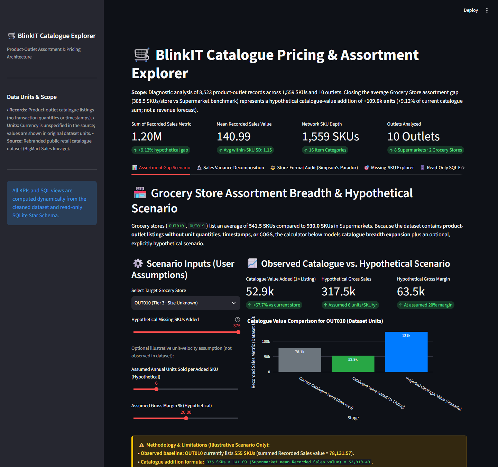

# BlinkIT Grocery Pricing & Catalogue Architecture Analysis


## Executive Summary

An end-to-end **Python, SQL (SQLite Star Schema), and Streamlit** analytics project investigating product pricing structure, store-format assortment breadth, Simpson's Paradox confounding, and SKU-level variance decomposition across **8,523 product-outlet catalogue records**, **1,559 unique SKUs**, and **10 retail outlets**.

> **Transparency & Units Notice:** Currency units are **not specified** in the source dataset, so all values are reported in original dataset units without currency conversion. Variance decomposition ($R^2 = 99.97\%$) demonstrates that the `Sales` field behaves like a **SKU-level unit price / catalogue value**, not verified transaction revenue. See [Data Provenance & Licensing Restrictions](#data-provenance--licensing-restrictions) and [Important Data Limitations](#important-data-limitations).

---

## Live Streamlit Dashboard Preview



---

## Business & Analytical Objectives

1. **Audit what the `Sales` field actually measures** using one-way ANOVA variance decomposition ($R^2$) across SKU, category, and outlet dimensions.
2. **Test for store-format confounding (Simpson's Paradox)** when comparing location tiers (`Tier 1`, `Tier 2`, `Tier 3`) with and without Grocery Store outlets.
3. **Quantify outlet assortment breadth gaps** between Supermarket formats and Grocery Stores (`OUT010`, `OUT019`) and surface missing-SKU expansion candidates.
4. **Engineer a reproducible data pipeline and dimensional SQL Star Schema** (`dim_products`, `dim_outlets`, `fact_inventory_pricing`) with enforced foreign keys, unique grain, and 5 analytical views.
5. **Deliver an interactive, read-only Streamlit decision-support application** that strictly separates observed catalogue metrics from user-controlled hypothetical scenarios.

---

## Dataset Overview

| Metric | Verified Value |
|---|---:|
| Product-outlet records | `8,523` (`0` nulls after cleaning, `0` duplicate pairs) |
| Unique SKUs (`Item Identifier`) | `1,559` |
| Outlets (`Outlet Identifier`) | `10` (`8` Supermarkets · `2` Grocery Stores) |
| Product categories (`Item Type`) | `16` (`Food`, `Drinks`, `Non-Consumable`) |
| Sum of Recorded `Sales` Metric | `1,201,681.49` *(original dataset units)* |
| Mean / Median Recorded `Sales` Value | `140.99` / `143.01` *(min `31.29`, max `266.89`, SD `62.28`)* |
| Average Rating | `3.97 / 5` (`39.18%` rated exactly `4.0`) |

---

## Data Provenance & Licensing Restrictions

- **Attribution:** Forensic inspection confirms that the source workbook (`8,523` rows, `1,559` SKUs, `OUT010`–`OUT049`, `Sales` range `31.29`–`266.89`) is derived from the **Analytics Vidhya BigMart Sales** practice dataset.
- **Non-Redistribution Policy:** Analytics Vidhya classifies this dataset as proprietary and restricts public third-party redistribution. Accordingly, **neither the source Excel workbook (`BlinkIT Grocery Data.xlsx` / `BlinkIT_Grocery_Data.xlsx`) nor the derived cleaned CSV (`BlinkIT_Grocery_Data_Cleaned.csv`) is redistributed in this repository**, and no open data license is claimed.
- **Authorized Local Access Required:** This project **cannot execute out of the box immediately after cloning** until you obtain the source dataset through its authorized source (your Analytics Vidhya DataHack account under their platform terms of use) and place the workbook in `BlinkIT-Grocery-Sales-Analysis/`.

---

## Important Data Limitations

- **Catalogue Value vs. Actual Revenue:** `Sales` behaves like a SKU-level unit price (`99.97%` variance explained by `Item Identifier`). Summing `Sales` at the store level measures **catalogue assortment value**, not realized transaction revenue.
- **No Units Sold, Timestamps, or COGS:** The dataset lacks transaction quantities, dates, seasonality, and cost of goods sold. Actual revenue, price elasticity, demand velocity, and gross profit cannot be established from these records alone.
- **Currency Unspecified:** All numeric values are reported in original dataset units without currency symbols or conversion.
- **Hypothetical Scenarios:** The Tab 1 scenario calculator in `app.py` explicitly separates observed catalogue listings from user-controlled unit-velocity and gross-margin sliders; outputs are illustrative scenarios, not financial forecasts.

---

## Key Analytical Findings

1. **Variance Decomposition — `Sales` Is SKU-Driven ($R^2 = 99.97\%$):** One-way ANOVA decomposition shows `Item Identifier` alone explains **99.97%** of the variance in `Sales` (Adjusted $R^2 = 0.9996$; average within-SKU SD = `1.15` vs. `62.28` overall; max cross-store spread = `4.00`). Outlet identity explains only `0.03%`.
2. **Store-Format Composition Audit (Simpson's Paradox):** Naive tier averages make Tier 2 (`131,050` per store) appear ahead of Tier 1 (`112,133`) and Tier 3 (`118,033`). Controlling for store format (Supermarkets only) collapses the tier spread to **0.2%** (`Tier 1: 131,295`, `Tier 2: 131,050`, `Tier 3: 131,334`). The naive gap is a **composition effect**—Tier 2 has zero Grocery Stores, while Tier 1 (`OUT019`) and Tier 3 (`OUT010`) each contain one.
3. **Outlet Assortment Breadth Gap:** Supermarkets average **930.0 SKUs** vs. **541.5 SKUs** in Grocery Stores (**388.5 SKUs/store** gap). Valued at the Supermarket mean Recorded Sales value (`141.09`), closing this listing gap across both Grocery Stores corresponds to a hypothetical catalogue-value addition of **+109,630.35 units (+9.12%)**—an illustrative catalogue scenario, not a revenue forecast.
4. **Category Concentration (Pareto):** The top 5 of 16 categories (`Fruits and Vegetables`, `Snack Foods`, `Household`, `Frozen Foods`, `Dairy`) account for **59.03%** (`709,369.87`) of the summed Recorded Sales metric, closely mirroring their **57.26%** listing-count share.
5. **Data Quality Engineering:** Imputed `1,463` missing `Item Weight` values via SKU mean (constant per SKU) with category-median fallback for 4 all-null SKUs; imputed `526` zero `Item Visibility` entries; harmonized `Item Fat Content` into `Low Fat`, `Regular`, and `Non-Edible`; and flagged 3 outlets with contradictory raw `Outlet Size` labels (`OUT010`, `OUT017`, `OUT045`) as `Unknown` while preserving `Outlet Size (Original)`.

---

## Technical Architecture

```text
Authorized Source Workbook (local only, gitignored)
  BlinkIT Grocery Data.xlsx / BlinkIT_Grocery_Data.xlsx
        │
        ▼  [1. Cleaning, Imputation, Statistical Testing & 10 Static Charts]
  run_analysis.py  ──► visuals/*.png (10 core charts)
        │          ──► BlinkIT_Grocery_Data_Cleaned.csv (local only, gitignored)
        ▼  [2. Dimensional ETL & Constraint Verification]
  build_warehouse.py + blinkit_warehouse.sql
        │          ──► blinkit_warehouse.db (local SQLite Star Schema, gitignored)
        ▼  [3. Read-Only Interactive Decision-Support App]
  app.py (Streamlit + Plotly, sqlite3 URI mode=ro + SELECT/WITH SQL guard)
```

All scripts resolve file paths relative to `Path(__file__).resolve().parent`, ensuring consistent behavior whether invoked from inside `BlinkIT-Grocery-Sales-Analysis/` or from the repository root.

---

## SQL Star Schema (`blinkit_warehouse.sql`)

- **Dimension & Fact Tables (`PRAGMA foreign_keys = ON`):**
  - `dim_products` (`1,559` rows) — SKU attributes (`item_identifier`, `product_family`, `item_type`, `item_fat_content`, `item_weight`, `is_edible`).
  - `dim_outlets` (`10` rows) — Store attributes (`outlet_identifier`, `outlet_type`, `outlet_location_tier`, `outlet_size`, `establishment_year`, `outlet_age`).
  - `fact_inventory_pricing` (`8,523` rows) — Grain: `UNIQUE(product_key, outlet_key)`, storing `item_visibility`, `sales_mrp`, and `customer_rating` with enforced foreign keys to both dimensions.
- **Pre-Built Analytical Views:**
  1. `vw_sku_pricing_variance` — Cross-store mean, min, max, and spread of `sales_mrp` per SKU.
  2. `vw_outlet_assortment_gap` — Store SKU counts, `total_catalogue_value`, and gap vs. Supermarket benchmark.
  3. `vw_format_controlled_tiers` — `total_catalogue_value` and `catalogue_value_per_store` by Tier × Format.
  4. `vw_category_pareto` — `category_sales_metric`, `sales_metric_share_pct`, and cumulative Pareto curve via window functions.
  5. `vw_missing_sku_prioritization` — 658 SKUs stocked in 1–8 Supermarkets and absent from Grocery Stores.

---

## Streamlit Dashboard Features (`app.py`)

- **Dynamic KPI Strip:** 4 top-level metrics computed live from the cleaned dataset with explanatory tooltips.
- **Tab 1 — Assortment Gap Scenario:** Select a Grocery Store (`OUT010` or `OUT019`), adjust hypothetical added SKUs plus optional unit-velocity and margin assumptions, and inspect observed vs. illustrative scenario charts with explicit methodology caveats.
- **Tab 2 — Sales Variance Decomposition:** Visualizes $R^2$ variance share across SKU, Category, and Outlet alongside an interactive SKU cross-store scatter plot.
- **Tab 3 — Store-Format Audit (Simpson's Paradox):** Toggle between the confounded naive tier view and the format-controlled Supermarkets-only view.
- **Tab 4 — Missing-SKU Explorer:** Filter 658 candidate SKUs by product family, category, and minimum Supermarket presence; export filtered candidates to CSV (automatically disabled when no records match).
- **Tab 5 — Read-Only SQL Explorer:** Inspect all 5 warehouse views or execute custom single-statement `SELECT`/`WITH` queries against a strictly read-only SQLite connection (`mode=ro`) protected by `validate_readonly_sql()`.

---

## Project Directory Structure

```text
BlinkIT-Grocery-Sales-Analysis/
├── app.py                                   # 5-tab Streamlit app (read-only SQLite + Plotly)
├── blinkit_warehouse.sql                    # SQLite Star Schema DDL (UNIQUE grain, FKs) + 5 views
├── build_warehouse.py                       # CWD-independent SQLite ETL builder & view verifier
├── run_analysis.py                          # Cleaning, statistical testing & 10-chart export pipeline
├── BlinkIT_Grocery_Sales_Analysis_v2.ipynb  # Canonical Jupyter analysis notebook (33 code cells)
├── dashboard_live_screenshot.png            # Live Streamlit dashboard preview
├── requirements.txt                         # Python package requirements
├── REMEDIATION_CHANGELOG.md                 # Engineering & audit remediation changelog
├── .gitignore                               # Excludes .venv/, secrets, restricted datasets, *.db, logs
└── visuals/                                 # 12 high-resolution portfolio charts
```

> **Excluded Local Files (via `.gitignore`):** `.venv/`, `BlinkIT Grocery Data.xlsx`, `BlinkIT_Grocery_Data.xlsx`, `BlinkIT_Grocery_Data_Cleaned.csv`, `blinkit_warehouse.db`, `.env*`, and temporary exports/logs are strictly excluded and must not be committed to GitHub.

---

## Installation Instructions

> **Prerequisite:** Obtain the authorized source dataset (`BlinkIT Grocery Data.xlsx` or `BlinkIT_Grocery_Data.xlsx`) from Analytics Vidhya and place it inside `BlinkIT-Grocery-Sales-Analysis/` before running the scripts or dashboard.

### macOS / Linux

```bash
cd BlinkIT-Grocery-Sales-Analysis
python3 -m venv .venv
source .venv/bin/activate
python -m pip install --upgrade pip
python -m pip install -r requirements.txt
```

---

## Windows-Specific Setup Instructions (PowerShell)

On Windows 11, PowerShell execution policies often block virtual environment activation scripts (`Activate.ps1`). You do **not** need to relax PowerShell execution policies—invoke `.venv\Scripts\python.exe` directly from the `BlinkIT-Grocery-Sales-Analysis` directory:

```powershell
py -3.14 -m venv .venv

.\.venv\Scripts\python.exe -m pip install --upgrade pip

.\.venv\Scripts\python.exe -m pip install -r requirements.txt

.\.venv\Scripts\python.exe -m streamlit run app.py
```

- **Local Environment Only:** `.venv/` is a local Python virtual environment excluded by `.gitignore` and must **never** be committed to GitHub.
- **Stopping Streamlit:** Press `Ctrl+C` in the PowerShell terminal where Streamlit is running to stop the local server cleanly.

---

## How to Run the Analysis Pipeline

After placing your authorized `BlinkIT Grocery Data.xlsx` (or `BlinkIT_Grocery_Data.xlsx`) workbook in `BlinkIT-Grocery-Sales-Analysis/`:

```powershell
# Windows PowerShell (from BlinkIT-Grocery-Sales-Analysis/)
.\.venv\Scripts\python.exe run_analysis.py
```

This generates `BlinkIT_Grocery_Data_Cleaned.csv` locally, prints variance decomposition and hypothesis-test outputs, and exports the 10 core figures to `visuals/`.

---

## How to Build the SQL Warehouse

```powershell
# Windows PowerShell (from BlinkIT-Grocery-Sales-Analysis/)
.\.venv\Scripts\python.exe build_warehouse.py
```

This builds `blinkit_warehouse.db` from `blinkit_warehouse.sql` and `BlinkIT_Grocery_Data_Cleaned.csv`, verifies foreign-key integrity (`0` violations), and validates all 5 analytical SQL views.

---

## How to Launch Streamlit

```powershell
# Windows PowerShell (from BlinkIT-Grocery-Sales-Analysis/)
.\.venv\Scripts\python.exe -m streamlit run app.py
```

- If `blinkit_warehouse.db` does not exist yet (and `BlinkIT_Grocery_Data_Cleaned.csv` is present), `app.py` automatically builds the warehouse before opening it in read-only mode (`mode=ro`).
- Press `Ctrl+C` in the terminal to stop the Streamlit server.

---

## Troubleshooting

| Symptom | Cause & Safe Resolution |
|---|---|
| **`Activate.ps1 cannot be loaded because running scripts is disabled`** | Standard Windows PowerShell execution policy restriction. Do not weaken system policies—invoke `.\.venv\Scripts\python.exe` directly as shown in [Windows-Specific Setup Instructions](#windows-specific-setup-instructions-powershell). |
| **Windows Application Control / Smart App Control blocks a compiled Python extension (`.pyd` / `.dll`)** | Some pre-release or unsigned Python builds can trigger Windows Application Control when loading compiled wheels (e.g., `pandas`, `numpy`). Do **not** disable Windows security controls. Instead, install an official signed Python release from [python.org](https://www.python.org/downloads/windows/) (this project is verified on **Python 3.14**), recreate `.venv` with `py -3.14 -m venv .venv`, and reinstall official wheels via `.\.venv\Scripts\python.exe -m pip install -r requirements.txt`. |
| **`Cleaned dataset not found` when launching `app.py`** | The restricted source dataset is not distributed in GitHub. Place your locally obtained `BlinkIT Grocery Data.xlsx` in `BlinkIT-Grocery-Sales-Analysis/` and run `.\.venv\Scripts\python.exe run_analysis.py` first. |
| **Port `8501` already in use** | Launch Streamlit on an alternate port: `.\.venv\Scripts\python.exe -m streamlit run app.py --server.port 8502`. |

---

## Tools & Technologies

- **Python (`3.14` tested):** `pandas`, `numpy`, `scipy`, `matplotlib`, `seaborn`, `openpyxl`
- **SQL & Relational Modeling:** SQLite Star Schema (`blinkit_warehouse.sql`), foreign-key & unique-grain constraints, window-function Pareto views
- **Interactive Visualization & App:** `streamlit>=1.50.0`, `plotly>=5.15.0`
- **Notebooks:** `jupyter`, `nbformat` (`BlinkIT_Grocery_Sales_Analysis_v2.ipynb`)

---

## Author & Links

**Pooja Singh**
- GitHub Profile: [https://github.com/PoojaS-1616](https://github.com/PoojaS-1616)
- Portfolio Repository: [https://github.com/PoojaS-1616/data-analysis](https://github.com/PoojaS-1616/data-analysis)
