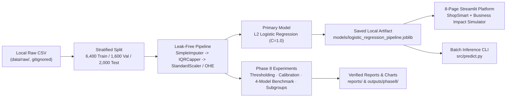

# ShopSmart — E-Commerce Customer Purchase Prediction


**ShopSmart — Purchase Intelligence Platform** is an end-to-end, leakage-audited Data Science & ML Engineering portfolio project and **8-page interactive Streamlit application** that estimates **cart-stage / pre-checkout purchase intent** (`Purchase` = `1` vs. `0`) using an interpretable **L2-regularized Logistic Regression** `scikit-learn` pipeline — backed by leakage-safe threshold selection, probability calibration diagnostics, 4-model comparative benchmarking, subgroup robustness analysis, and an interactive **Business Impact & ROI Simulator**.

> **Prediction Timing Scope:** This is a **CART-STAGE / PRE-CHECKOUT PURCHASE INTENT** model. Predictions rely on active cart features (`Cart_Items`, `Cart_Value_INR`, `Discount_Percent`) alongside session and customer profile attributes. It does **not** predict purchases before shopping or cart creation begins.

---

## 1. Business Problem

E-commerce growth and CRM teams frequently over-spend on blanket checkout discounts (eroding margin on high-intent buyers who would convert anyway) while under-investing in targeted nudges for persuadable mid-intent cart sessions. ShopSmart provides calibrated purchase probability estimates, probability-tiered marketing segments, and scenario-based campaign ROI modeling to support disciplined, A/B-tested checkout interventions.

---

## 2. System Architecture



---

## 3. Dataset Description & Provenance

- **Dimensions:** `10,000` customer sessions × `19` columns (`0` exact duplicates; `10,000` unique `Customer_ID` values dropped prior to modeling).
- **Target (`Purchase`):** `6,480` purchases (`64.80%`) and `3,520` non-purchases (`35.20%`).
- **Features (`17` inputs):** `5` categorical (`Gender`, `Device_Type`, `Traffic_Source`, `Membership_Type`, `Payment_Method`) + `12` numeric (`Age`, `Session_Duration_Min`, `Pages_Viewed`, `Products_Viewed`, `Cart_Items`, `Cart_Value_INR`, `Discount_Percent`, `Previous_Orders`, `Days_Since_Last_Visit`, `Email_Open_Rate`, `Customer_Rating`, `Returns_Last_Year`).
- **Missingness:** `2,514` nulls across `11` columns, imputed strictly inside `ColumnTransformer` on training folds only.
- **Data Access & Governance:** The raw dataset (`Ecommerce_Purchase_Prediction_DataSet.csv`) and customer-level exports (`outputs/*.csv`) are **excluded from GitHub via `.gitignore`** because upstream provenance and redistribution rights remain unverified. Place your authorized local copy at `data/raw/Ecommerce_Purchase_Prediction_DataSet.csv` before running training or experiments. See [DATA_PROVENANCE.md](DATA_PROVENANCE.md).

---

## 4. Verified Model Performance & Phase 8 Experimental Results

> **Held-Out Test vs. Production Performance:** All metrics below are **offline held-out test (`n = 2,000`) and validation (`n = 1,600`) results** on historical data. Production performance may differ under drift or catalog changes and must be monitored continuously.

### A. 4-Model Comparative Benchmark (`outputs/phase8/model_comparison/model_comparison.csv`)

All four models were tuned on identical `6,400 / 1,600` train/validation splits and evaluated once on the untouched `2,000`-row test set (`t = 0.50`):

| Model | Val-Selected Config | Test ROC-AUC | Test PR-AUC | Test F1 | Test Acc | Test Log-Loss | Test Brier | Test ECE | Inference (2k rows) |
|---|---|---:|---:|---:|---:|---:|---:|---:|---:|
| **LogisticRegression (Selected)** | `C=0.1` *(prod `C=1.0`: `0.7411`)* | **`0.7405`** | **`0.8384`** | `0.7917` | **`0.7030`** | **`0.5599`** | **`0.1905`** | `0.0240` | **`15.52 ms`** |
| **RandomForest** | `depth=10, leaf=5` | `0.7344` | `0.8329` | `0.8003` | `0.6950` | `0.5815` | `0.1984` | `0.0603` | `66.10 ms` |
| **HistGradientBoosting** | `depth=3, lr=0.05` | `0.7302` | `0.8311` | `0.7893` | `0.6955` | `0.5699` | `0.1943` | `0.0218` | `17.10 ms` |
| **DummyClassifier** | `strategy=prior` | `0.5000` | `0.6480` | `0.7864` | `0.6480` | `0.6487` | `0.2281` | `0.0000` | `13.12 ms` |

**Why Logistic Regression Remains Selected:** It outperforms both tree ensembles on ROC-AUC, PR-AUC, Accuracy, Log-Loss, and Brier Score while running **4.3× faster** than Random Forest and providing direct standardized odds ratios (`Cart_Items OR = 1.84`, `Membership_Type_Premium OR = 1.72`, `Cart_Value_INR OR = 1.50`). See [PHASE8_MODEL_COMPARISON_REPORT.md](reports/PHASE8_MODEL_COMPARISON_REPORT.md).


### B. Probability Calibration Diagnostics (`outputs/phase8/calibration/`)

Evaluated uncalibrated LR vs. 5-fold Sigmoid vs. 5-fold Isotonic calibration strictly on validation (`n = 1,600`) before untouched test evaluation (`n = 2,000`):
- **Validation Winner:** **Uncalibrated L2 Logistic Regression** (`Val Brier = 0.1931`, `Log-Loss = 0.5672`, `Slope = 1.0098`, `Intercept = -0.0249`, `ECE = 0.0208`).
- **Untouched Test Confirmation:** `Test Brier = 0.1903`, `Log-Loss = 0.5594`, `ECE (10-bin uniform) = 0.0236`. See [PHASE8_CALIBRATION_REPORT.md](reports/PHASE8_CALIBRATION_REPORT.md).


### C. Leakage-Safe Threshold Selection (`reports/PHASE8_THRESHOLD_SELECTION_REPORT.md`)

Thresholds were selected strictly on validation (`n = 1,600`, cross-checked via 5-fold OOF) and locked before single evaluation on untouched test (`n = 2,000`):
- **Default (`t = 0.50`):** `Prec = 0.7279`, `Rec = 0.8688`, `F1 = 0.7921`, `Targets = 77.35%`.
- **Validation F1-Optimal (`t = 0.40`):** `Prec = 0.6930`, `Rec = 0.9545`, `F1 = 0.8030`, `Targets = 89.25%` (demonstrates why highest F1 is not automatically best under constrained campaign budgets).
- **High-Recall (`t = 0.47`):** `Prec = 0.7198`, `Rec = 0.9020`, `Acc = 0.7090`.
- **High-Precision (`t = 0.67`):** `Prec = 0.8083`, `Rec = 0.6181`, `Targets = 49.55%` (reduces false positives from `421` to `190`).
- **Cost-Sensitive (`t = 0.30`):** Utility-optimal under illustrative `₹180` TP gain vs. `₹65` FP cost.

### D. Subgroup & Robustness Analysis (`reports/PHASE8_ROBUSTNESS_REPORT.md`)

Evaluated across `Device_Type`, `Membership_Type`, `Traffic_Source`, `Age_Group`, and target classes with strict minimum-sample guardrails (`n >= 50` and `min class >= 10`; `5` small slices including `Age 60+` `n=13` suppressed cleanly):
- Across all `15` valid subgroups, ROC-AUC remains stable between **`0.7007` and `0.7693`** (`Desktop = 0.7573` vs. `Mobile = 0.7321`; `Paid Ads = 0.7693`; `Age 26–35 = 0.7579`).

---

## 5. Interactive Streamlit Platform (8 Pages)

The application loads `models/logistic_regression_pipeline.joblib` via `@st.cache_resource` (never retrains on launch) and scores uploaded batch CSVs strictly in memory:

1. **Executive Overview** — Dataset KPIs vs. held-out test prediction distribution & limitations.
2. **Customer Analytics** — Interactive cohort filtering across profile, session, and cart features.
3. **Model Performance** — Verified test metrics, ROC/PR/calibration curves, threshold sweep, and IQR/leakage ablations.
4. **Single Customer Prediction** — Cart-stage form returning probability gauge, class, segment, and campaign action.
5. **Batch Prediction** — Validated in-memory CSV scoring with unlabelled template download and CSV export.
6. **Business Insights** — Standardized log-odds drivers, odds ratios, and non-causal interpretation.
7. **Model Information** — Version, evaluation date, 17 selected features, preprocessing, timing scope, and limitations.
8. **Business Impact Simulator (New in Phase 8)** — Interactive campaign ROI, budget utilization, break-even uplift, threshold profit sweep, and Conservative / Base / Optimistic scenario modeling (explicitly separating observed model predictions from user-defined uplift assumptions requiring A/B testing).

### Application Screenshots
*Live desktop UI screenshots are not included in this release because automated headless browser capture was unavailable in the non-interactive Windows build environment. Diagnostic ML, calibration, model-comparison, and subgroup figures are included in `outputs/figures/` and `outputs/phase8/`.*

---

## 6. Installation, Execution & Testing (Windows PowerShell · Python 3.14)

```powershell
py -3.14 -m venv .venv
.\.venv\Scripts\python.exe -m pip install --upgrade pip
.\.venv\Scripts\python.exe -m pip install -r requirements.txt
```

```powershell
# 1. Train primary pipeline (requires local data/raw/Ecommerce_Purchase_Prediction_DataSet.csv)
.\.venv\Scripts\python.exe src\train_pipeline.py

# 2. Run Phase 8 validation, calibration, model comparison & subgroup robustness suite
.\.venv\Scripts\python.exe src\phase8_experiments.py

# 3. Launch the 8-page Streamlit application
.\.venv\Scripts\python.exe -m streamlit run app\app.py

# 4. Run CLI batch prediction (direct script or module)
.\.venv\Scripts\python.exe src\predict.py --input path\to\new_customers.csv --output outputs\batch_scores.csv

# 5. Run complete automated test suite (16/16 passing)
.\.venv\Scripts\python.exe -m pytest tests/ -v
```

---

## 7. Model Limitations

- **Cart-Stage Only:** Requires active cart features; dropping cart variables lowers Test ROC-AUC from `0.7411` to `0.6697`.
- **Associational, Not Causal:** Odds ratios and simulator uplift scenarios do not prove causation; validate interventions with randomized A/B tests.
- **Probabilistic Estimates:** Outputs represent conversion probabilities, not purchase guarantees.
- **No Fairness Certification:** Subgroup analysis checks offline error consistency only and does not eliminate demographic or behavioral bias.

---

## 8. Technical Reports & Documentation

- [Model Validation Report (Historical Baseline)](reports/MODEL_VALIDATION_REPORT.md)
- [Phase 8.1 — Threshold Selection Report](reports/PHASE8_THRESHOLD_SELECTION_REPORT.md)
- [Phase 8.2 — Probability Calibration Report](reports/PHASE8_CALIBRATION_REPORT.md)
- [Phase 8.3 — Model Comparison Report](reports/PHASE8_MODEL_COMPARISON_REPORT.md)
- [Phase 8.5 — Subgroup & Robustness Report](reports/PHASE8_ROBUSTNESS_REPORT.md)
- [Phase 8 — Reproducibility Guide](reports/PHASE8_REPRODUCIBILITY_REPORT.md)
- [Phase 8 — Final QA Report](reports/PHASE8_FINAL_QA_REPORT.md)
- [Phase 8 — Changelog](reports/PHASE8_CHANGELOG.md)
- [Data Provenance & Governance](DATA_PROVENANCE.md)

**Author / GitHub:** `PoojaS-1616` · Portfolio Repository: `PoojaS-1616/data-analysis` (`ShopSmart-Ecommerce-Purchase-Prediction/`)
