# ShopSmart — E-Commerce Customer Purchase Prediction

**Cart-Stage / Pre-Checkout Purchase Intelligence Platform with Leakage-Safe ML Validation, Calibration, Subgroup Robustness & Interactive ROI Simulation**


-0F2942?style=for-the-badge)

> An end-to-end purchase-intelligence platform combining leakage-safe machine learning, probability calibration, business-oriented decision thresholds and interactive campaign ROI simulation.

---

## Quick Navigation

- [Executive Overview](#executive-overview)
- [Project Highlights](#project-highlights)
- [System Architecture](#system-architecture)
- [Dataset and Data Governance](#dataset-and-data-governance)
- [Machine Learning Methodology](#machine-learning-methodology)
- [Model Performance Dashboard](#model-performance-dashboard)
- [Threshold Selection](#threshold-selection)
- [Probability Calibration](#probability-calibration)
- [Business Impact Simulator](#business-impact-simulator)
- [Subgroup Robustness](#subgroup-robustness)
- [Application Gallery (8 Live Pages)](#application-gallery)
- [Technology Stack](#technology-stack)
- [Project Structure](#project-structure)
- [Installation and Execution](#installation-and-execution)
- [Testing and Reproducibility](#testing-and-reproducibility)
- [Limitations and Future Improvements](#limitations-and-future-improvements)
- [Author and Project Links](#author-and-project-links)

**Companion Docs:** [Quickstart Guide](docs/QUICKSTART.md) · [Technical Walkthrough](docs/TECHNICAL_WALKTHROUGH.md) · [2-Minute Project Summary](docs/PROJECT_SUMMARY.md) · [Demo Video Storyboard](docs/DEMO_VIDEO_STORYBOARD.md)

---

## Executive Overview

- **Business Problem:** E-commerce CRM and growth teams lose margin by sending blanket checkout discounts to high-intent buyers who would convert anyway, while under-targeting persuadable mid-intent carts.
- **Target Users:** Growth analysts, CRM managers, and marketing data scientists evaluating cart-abandonment nudges and incentive budgets.
- **What It Predicts:** Binary checkout conversion probability (`Purchase = 1` vs. `0`) and probability-tiered marketing intent segments (`High`, `Medium`, `Low-Medium`, `Low`).
- **When Predictions Are Generated (Critical Scope Boundary):** Strictly at **cart-stage / pre-checkout** once active cart features (`Cart_Items`, `Cart_Value_INR`, `Discount_Percent`) exist alongside session and account attributes. **This is not a pre-shopping / landing-page visitor prediction model** (removing cart-stage features lowers Test ROC-AUC from `0.7411` to `0.6697`).
- **How It Supports Decisions:** Pairs calibrated conversion probabilities with operating-threshold trade-offs and a scenario-based **Business Impact Simulator** to test budget caps, unit costs, and break-even uplift prior to running controlled A/B experiments.

---

## Project Highlights

| Verified Dimension | Metric / Scope | Evidence Source |
|---|---|---|
| **Dataset Scope** | `10,000` customer sessions · `17` model features · `0` duplicates | `outputs/metrics_summary.json` |
| **Leakage-Safe Split** | 3-way stratified: `6,400` Train / `1,600` Validation / `2,000` Untouched Test | `reports/PHASE8_THRESHOLD_SELECTION_REPORT.md` |
| **Models Benchmarked** | `4` families (`Dummy`, `LogisticRegression`, `RandomForest`, `HistGradientBoosting`) | `outputs/phase8/model_comparison/model_comparison.csv` |
| **Primary Test Performance** | `ROC-AUC 0.7411` · `PR-AUC 0.8388` · `Brier 0.1903` · `ECE 0.0236` | `outputs/metrics_summary.json` & `phase8_summary.json` |
| **Interactive Application** | `8` Streamlit pages including interactive **Business Impact Simulator** | `app/app.py` & `docs/screenshots/` |
| **Automated Verification** | `16 / 16` passing `pytest` + `AppTest` tests · Live `/_stcore/health` `HTTP 200` | `tests/` & `reports/PHASE8_FINAL_QA_REPORT.md` |

---

## System Architecture

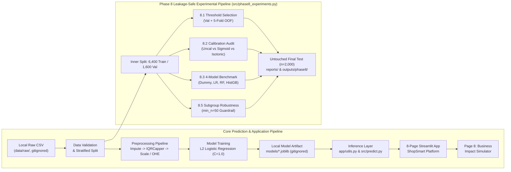

---

## Dataset and Data Governance

- **Dimensions:** `10,000` rows × `19` columns (`1` unique identifier `Customer_ID` dropped prior to modeling, `17` independent features, `1` binary target `Purchase`).
- **Target Distribution:** `Purchase = 1`: `6,480` (`64.80%`); `Purchase = 0`: `3,520` (`35.20%`).
- **Feature Groups:**
  - *Categorical (`5`):* `Gender`, `Device_Type`, `Traffic_Source`, `Membership_Type`, `Payment_Method`.
  - *Spike-Capped Numeric (`5`):* `Session_Duration_Min`, `Pages_Viewed`, `Cart_Value_INR`, `Discount_Percent`, `Days_Since_Last_Visit`.
  - *Standard Numeric (`7`):* `Age`, `Products_Viewed`, `Cart_Items`, `Previous_Orders`, `Email_Open_Rate`, `Customer_Rating`, `Returns_Last_Year`.
- **Missingness & Preprocessing:** `2,514` nulls across `11` columns, imputed strictly inside `ColumnTransformer` (training-fold medians/modes).
- **Governance & Access:** Upstream dataset provenance and redistribution rights are **unverified** ([DATA_PROVENANCE.md](DATA_PROVENANCE.md)). The raw CSV (`data/raw/*.csv`), customer-level exports (`outputs/*.csv`), and serialized model binaries (`models/*.joblib`) are excluded via [.gitignore](.gitignore). Place your authorized local copy at `data/raw/Ecommerce_Purchase_Prediction_DataSet.csv` before training.

---

## Machine Learning Methodology

1. **Leakage-Safe Split Design:** Preserves an **untouched `2,000`-row final test set** (`20%`, `random_state = 42`, stratified) that is never used for feature engineering, hyperparameter tuning, threshold selection, or calibration fitting. The `8,000` training rows are split into `6,400` inner train and `1,600` validation for all Phase 8 selection decisions.
2. **In-Fold Preprocessing (`src/preprocessing.py`):** Median/mode imputation, custom training-fold **IQR Winsorisation (`IQRCapper(k=1.5)`)** on the 5 right-tail spike columns (empirically validated: `+0.0339` Test ROC-AUC vs. uncapped raw), `StandardScaler`, and `OneHotEncoder(drop="first", handle_unknown="ignore")` yielding `26` transformed features.
3. **Evaluation Discipline:** Combines 5-fold stratified CV, validation-locked thresholding, probability calibration diagnostics, 4-model benchmarking, and subgroup robustness checks.

---

## Model Performance Dashboard

> **Model Version & Evaluation Protocol Note (Audit Transparency):**
> - **Local Application Artifact (`models/logistic_regression_pipeline.joblib`, Historical Phases 1–7):** `LogisticRegression(L2, C=1.0, IQR k=1.5)` fit on `8,000` training rows — Held-Out Test (`n = 2,000`, `t = 0.50`): **`ROC-AUC = 0.7411`**, **`PR-AUC = 0.8388`**, **`F1 = 0.7921`**, **`Accuracy = 0.7045`**, **`Log-Loss = 0.5594`**, **`Brier = 0.1903`**.
> - **Phase 8.3 Comparative Benchmark (`src/phase8_experiments.py`):** Controlled validation grid over `C in {0.1, 1.0, 5.0}` selected **`C = 0.1`** by `+0.0002` on `X_val` (`0.7357` vs `0.7355`), yielding untouched Test **`ROC-AUC = 0.7405`** and **`Brier = 0.1905`**. Both configurations perform virtually identically; the existing validated `C = 1.0` artifact is preserved untouched for historical continuity.

| Model (Phase 8.3 Benchmark) | Val-Selected Config | Test ROC-AUC | Test PR-AUC | Test F1 | Test Acc | Test Brier | Test Log-Loss | Inference (2k rows) |
|---|---|---:|---:|---:|---:|---:|---:|---:|
| **LogisticRegression (Selected)** | `C=0.1` *(app artifact `C=1.0`: `0.7411`)* | **`0.7405`** | **`0.8384`** | `0.7917` | **`0.7030`** | **`0.1905`** | **`0.5599`** | **`15.52 ms`** |
| **RandomForest** | `depth=10, leaf=5` | `0.7344` | `0.8329` | `0.8003` | `0.6950` | `0.1984` | `0.5815` | `66.10 ms` |
| **HistGradientBoosting** | `depth=3, lr=0.05` | `0.7302` | `0.8311` | `0.7893` | `0.6955` | `0.1943` | `0.5699` | `17.10 ms` |
| **DummyClassifier** | `strategy=prior` | `0.5000` | `0.6480` | `0.7864` | `0.6480` | `0.2281` | `0.6487` | `13.12 ms` |

**Why Logistic Regression Remains Selected:** It outperforms both tree ensembles on ROC-AUC, PR-AUC, Accuracy, Brier Score, and Log-Loss while running **4.3× faster** than Random Forest and exposing exact standardized odds ratios (`Cart_Items OR = 1.84`, `Membership_Type_Premium OR = 1.72`, `Cart_Value_INR OR = 1.50`). Full details: [PHASE8_MODEL_COMPARISON_REPORT.md](reports/PHASE8_MODEL_COMPARISON_REPORT.md).

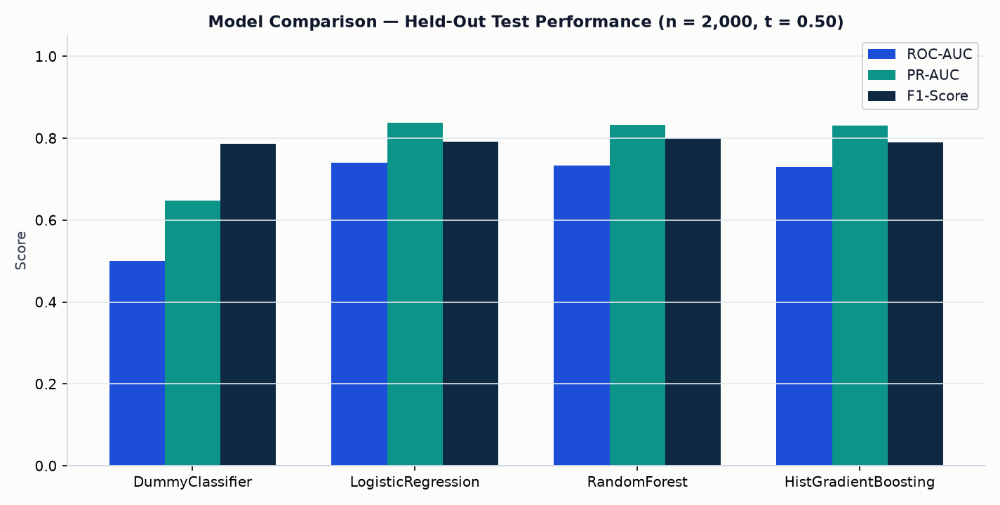

---

## Threshold Selection

Thresholds were selected strictly on validation (`n = 1,600`, cross-checked via 5-fold OOF) and locked before single evaluation on the untouched test set (`n = 2,000`):

| Strategy | Locked Threshold | Untouched Test Prec | Untouched Test Rec | Untouched Test F1 | Untouched Test Acc | Sessions Targeted | False Positives |
|---|---:|---:|---:|---:|---:|---:|---:|
| **Default** | `0.50` | `0.7279` | `0.8688` | `0.7921` | `0.7045` | `77.35%` | `421` |
| **Val F1-Optimal** | `0.40` | `0.6930` | `0.9545` | **`0.8030`** | `0.6965` | `89.25%` | `548` |
| **High-Recall (`>=0.90`)** | `0.47` | `0.7198` | `0.9020` | `0.8007` | **`0.7090`** | `81.20%` | `455` |
| **High-Precision (`>=0.80`)** | `0.67` | **`0.8083`** | `0.6181` | `0.7005` | `0.6575` | `49.55%` | **`190`** |
| **Cost-Sensitive (`₹180 / ₹65`)** | `0.30` | `0.6681` | `0.9892` | `0.7975` | `0.6745` | `95.95%` | `637` |

Lowering the threshold captures more buyers (`Recall -> 98.92%`) but inflates outreach volume and false positives (`637` FP); raising it to `0.67` cuts false positives by `54.9%` vs. default `0.50` for budget-constrained incentives. Full analysis: [PHASE8_THRESHOLD_SELECTION_REPORT.md](reports/PHASE8_THRESHOLD_SELECTION_REPORT.md).

---

## Probability Calibration

Reliable probabilities are essential for probability-tiered segments and financial forecasting. Comparing Uncalibrated LR vs. 5-fold Sigmoid vs. 5-fold Isotonic strictly on validation (`n = 1,600`) selected **Uncalibrated L2 Logistic Regression**:

- **Validation (`n = 1,600`):** `Brier = 0.1931`, `Log-Loss = 0.5672`, `Calibration Slope = 1.0098`, `Intercept = -0.0249`, `ECE (10-bin uniform) = 0.0208`.
- **Untouched Test (`n = 2,000`):** `Brier = 0.1903`, `Log-Loss = 0.5594`, `Slope = 1.0894`, `Intercept = -0.0476`, `ECE = 0.0236`.

Retaining native LR probabilities avoids unnecessary recalibration overfitting (Isotonic degraded validation ECE to `0.0310`) while preserving direct odds-ratio interpretability. Full report: [PHASE8_CALIBRATION_REPORT.md](reports/PHASE8_CALIBRATION_REPORT.md).

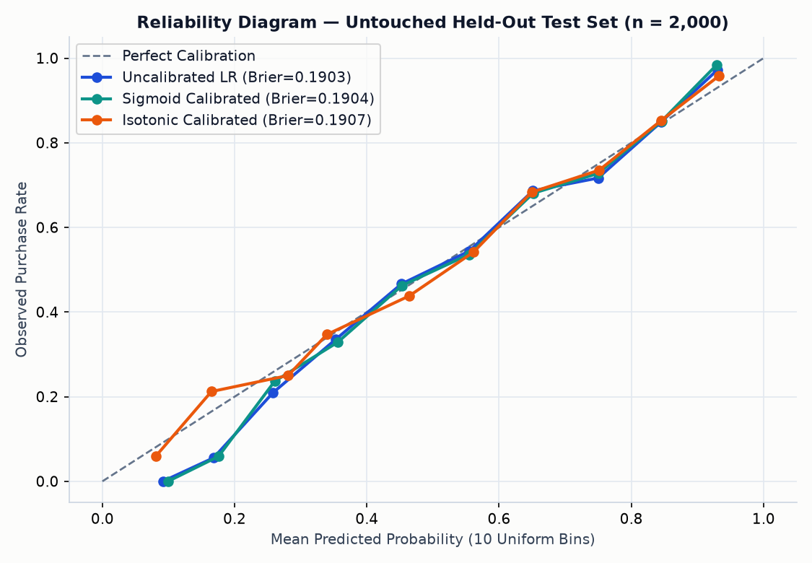

---

## Business Impact Simulator

**Page 8 (`app/pages/business_impact_simulator.py` + `src/business_simulator.py`)** translates observed model probabilities into campaign economics across **Conservative (`0.5x`)**, **Base (`1.0x`)**, and **Optimistic (`1.5x`)** uplift scenarios:

- **User Inputs:** Campaign budget (INR), cost per targeted customer, average order value (AOV), profit margin (%), expected incremental uplift (% pts), intervention effectiveness (%), decision threshold, and available customer volume.
- **Derived Outputs:** Customers selected (budget-capped), campaign expenditure, budget utilization, baseline conversions, incremental conversions, incremental revenue, incremental gross profit, net incremental profit, ROI, cost per incremental conversion, and break-even uplift.

> **Causal Disclaimer:** Scenario-based estimates are not causal treatment-effect estimates. Campaign uplift assumptions must be validated through controlled A/B experiments.

---

## Subgroup Robustness

Evaluated across `Device_Type`, `Membership_Type`, `Traffic_Source`, `Age_Group`, and target classes on the untouched test set (`n = 2,000`, `t = 0.50`) with strict minimum sample-size guardrails (**`n >= 50`** and **`min class count >= 10`**):

- **Suppressed Small Subgroups (`5` slices):** `Age 60+` (`n = 13`) and `Missing` slices (`n = 27–46`) are flagged and excluded from ranking metrics to prevent statistically noisy estimates.
- **Valid Subgroups (`15` slices):** ROC-AUC spans **`0.7007–0.7693`** (`Desktop = 0.7573` vs. `Mobile = 0.7321`; `Paid Ads = 0.7693`; `Age 26–35 = 0.7579`). This audit checks offline error consistency only and does **not** certify fairness. Full report: [PHASE8_ROBUSTNESS_REPORT.md](reports/PHASE8_ROBUSTNESS_REPORT.md).

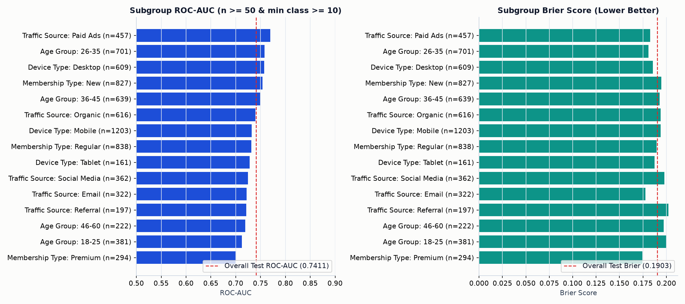

---

## Application Gallery

All 8 screenshots below were captured directly from the running local ShopSmart Streamlit application (`1440×900` desktop viewport, light theme):

| 1. Executive Overview | 2. Customer Analytics |
|---|---|
| 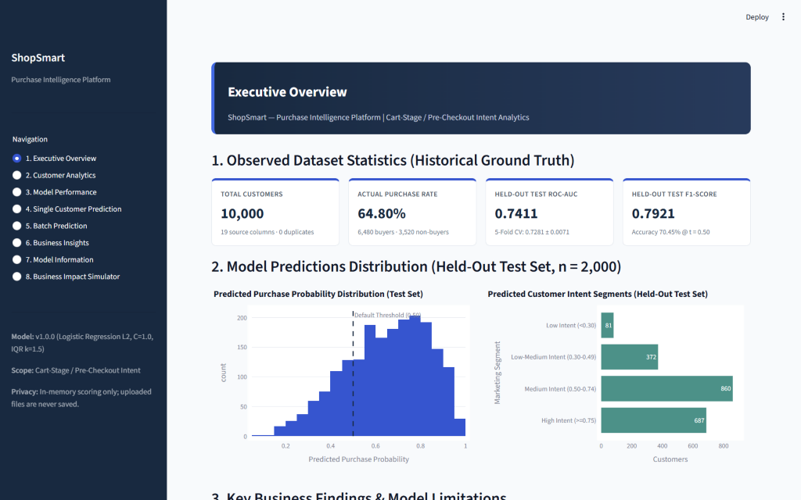 | 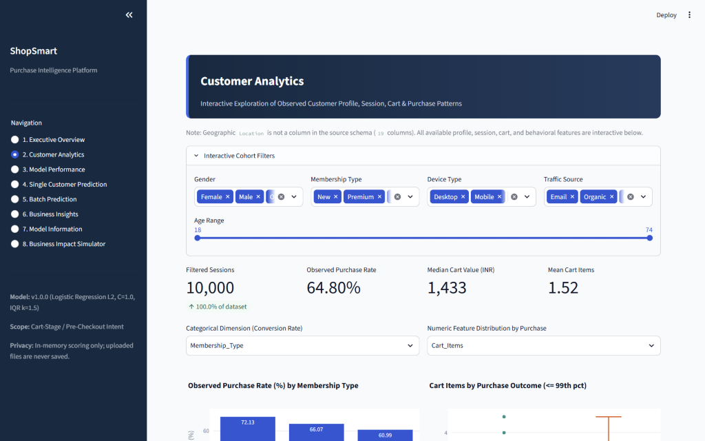 |

| 3. Model Performance | 4. Single Customer Prediction |
|---|---|
| 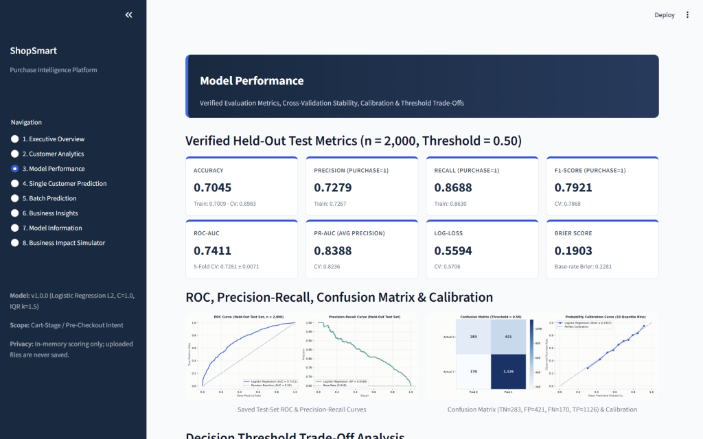 | 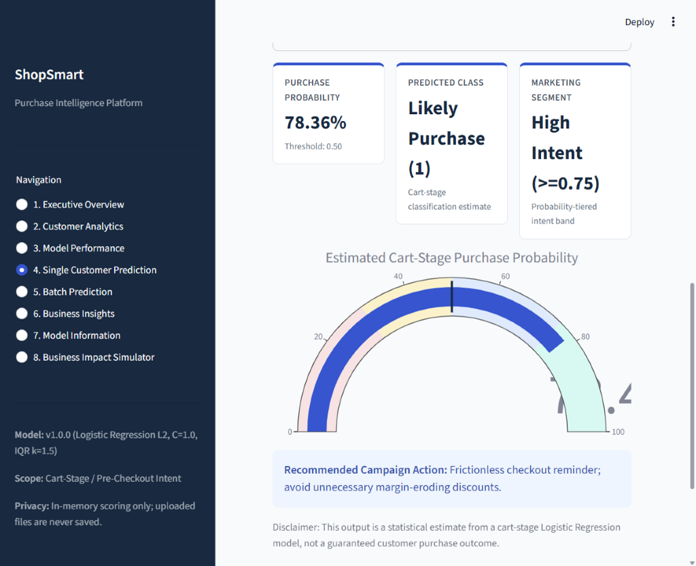 |

| 5. Batch Prediction | 6. Business Insights |
|---|---|
| 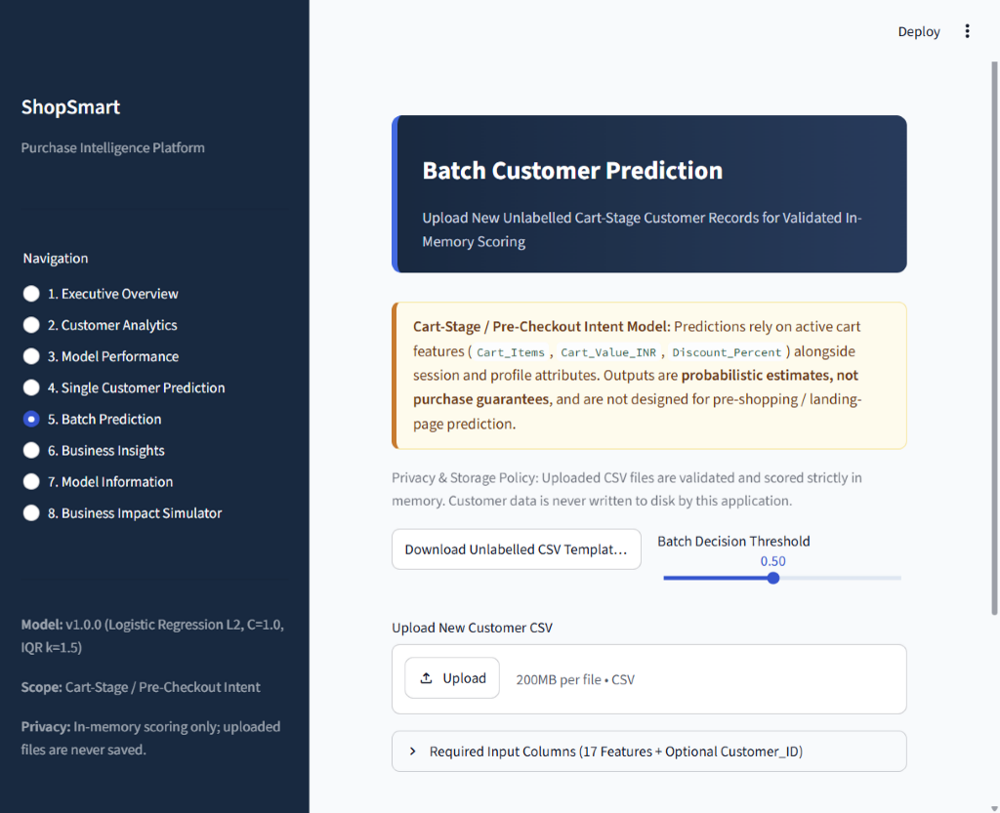 | 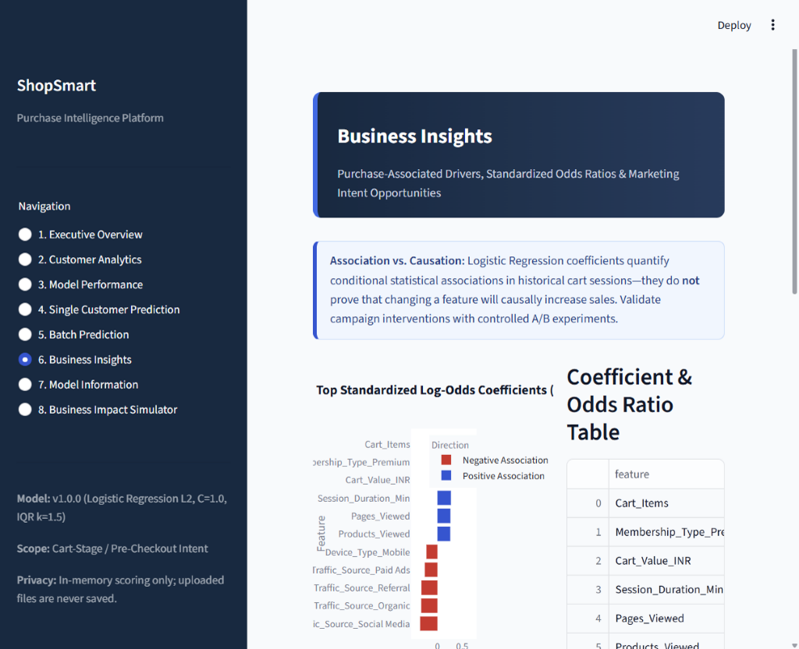 |

| 7. Model Information | 8. Business Impact Simulator |
|---|---|
| 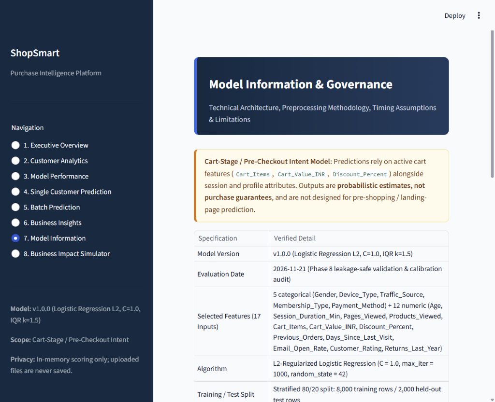 | 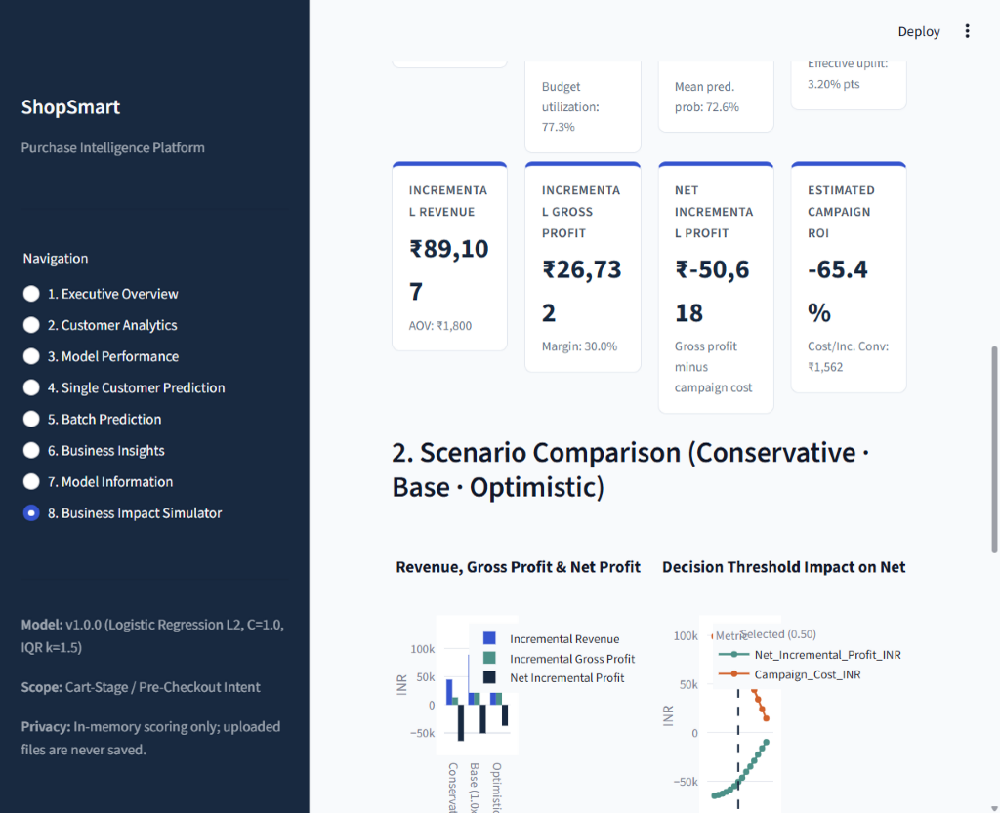 |

---

## Technology Stack

- **Programming Language:** Python `3.14.8`
- **Data Processing:** `pandas 3.1.1`, `numpy 2.5.5`, `scipy 1.18.1`
- **Machine Learning:** `scikit-learn 1.9.1`, `joblib 1.6.0`
- **Visualization:** `Plotly 7.1.0`, `matplotlib 3.11.2`, `seaborn 0.13.2`
- **Application Development:** `Streamlit 1.67.0`
- **Testing & Notebooks:** `pytest 9.2.0`, `streamlit.testing.v1.AppTest`, `nbformat 5.11.1`, `nbclient 0.11.0`
- **Version Control:** Git & GitHub

---

## Project Structure

```text
ShopSmart-Ecommerce-Purchase-Prediction/
├── .streamlit/config.toml              # Light theme & clean sidebar navigation config
├── app/                                # 8-page Streamlit platform (app.py, components.py, utils.py, pages/)
├── docs/                               # Quickstart, Technical Walkthrough, Project Summary, Storyboard & 8 screenshots
├── notebooks/                          # Executed 32-cell analytical notebook (0 errors; preview IDs sanitized)
├── outputs/
│   ├── figures/                        # 5 baseline diagnostic PNGs
│   ├── phase8/                         # Phase 8 calibration, model comparison & subgroup robustness charts/CSVs/JSON
│   ├── app_test_results.md             # Automated app verification summary
│   └── metrics_summary.json            # Historical verified baseline metrics
├── reports/                            # Historical validation report + 7 Phase 8 reports + Phase 9 QA report
├── src/                                # config.py, preprocessing.py, train_pipeline.py, predict.py, business_simulator.py, phase8_experiments.py
├── tests/                              # 16 automated tests (test_pipeline.py, test_app_predictions.py, test_phase8.py)
├── DATA_PROVENANCE.md                  # Unverified dataset license & exclusion policy
├── requirements.txt                    # Python 3.14 tested dependencies
└── .gitignore                          # Excludes .venv/, data/raw/*.csv, outputs/*.csv, models/*.joblib
```

---

## Installation and Execution

See the complete step-by-step guide in [docs/QUICKSTART.md](docs/QUICKSTART.md). Summary commands (Windows PowerShell):

```powershell
py -3.14 -m venv .venv
.\.venv\Scripts\python.exe -m pip install --upgrade pip
.\.venv\Scripts\python.exe -m pip install -r requirements.txt

# Place authorized local CSV at data\raw\Ecommerce_Purchase_Prediction_DataSet.csv, then:
.\.venv\Scripts\python.exe src\train_pipeline.py
.\.venv\Scripts\python.exe src\phase8_experiments.py
.\.venv\Scripts\python.exe -m streamlit run app\app.py
.\.venv\Scripts\python.exe -m pytest tests/ -v
```

---

## Testing and Reproducibility

- **Automated Test Suite:** `16 / 16` passing (`tests/test_pipeline.py`, `tests/test_app_predictions.py`, `tests/test_phase8.py`), including full 8-page `AppTest` navigation and simulator edge cases.
- **Environment Health:** `pip check` (`No broken requirements found.`); live Streamlit `/_stcore/health` verified `HTTP 200 ok`.
- **Reproducibility:** Fixed `RANDOM_STATE = 42` across splits, CV, and estimators; exact dependency versions documented in [PHASE8_REPRODUCIBILITY_REPORT.md](reports/PHASE8_REPRODUCIBILITY_REPORT.md).

---

## Limitations and Future Improvements

- **Current Limitations:** Cart-stage / pre-checkout scope only; unverified upstream dataset redistribution rights; offline historical evaluation only (no causal A/B uplift validation, no production drift monitoring, and no public cloud deployment).
- **Future Work:** Add a synthetic demo-data generator so clones can launch the UI without a local CSV; add GitHub Actions CI for `pytest`; evaluate production calibration drift over time.

---

## Author and Project Links

- **GitHub Profile:** [PoojaS-1616](https://github.com/PoojaS-1616)
- **Portfolio Repository:** [PoojaS-1616/data-analysis](https://github.com/PoojaS-1616/data-analysis)
- **ShopSmart Directory:** [ShopSmart-Ecommerce-Purchase-Prediction](https://github.com/PoojaS-1616/data-analysis/tree/main/ShopSmart-Ecommerce-Purchase-Prediction)
- **Other Portfolio Projects:** [Amazon India Business Performance](../amazon-indian-business-dashboard-main/) · [Supermart Grocery Sales](../Supermart-Grocery-Sales-Dashboard/) · [BlinkIT Grocery Pricing & Catalogue](../BlinkIT-Grocery-Sales-Analysis/) · [Smoking & Health Analysis](../Smoking_Health_Analysis/)
