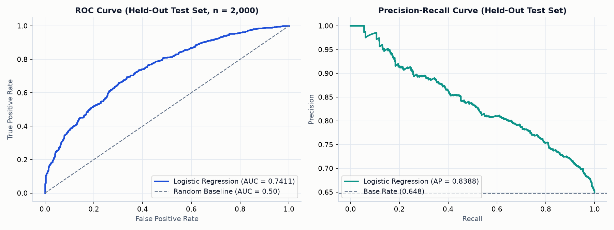
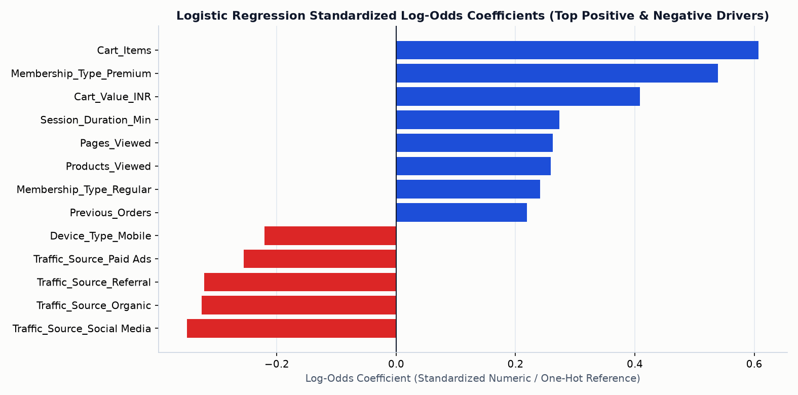

# ShopSmart — E-Commerce Customer Purchase Prediction


**ShopSmart — Purchase Intelligence Platform** is an end-to-end, leakage-audited Machine Learning portfolio project and 7-page interactive Streamlit application that estimates **cart-stage / pre-checkout purchase intent** (`Purchase` = `1` vs. `0`) using an interpretable **L2-regularized Logistic Regression** `scikit-learn` pipeline.

> **Prediction Timing Scope:** This is a **CART-STAGE / PRE-CHECKOUT PURCHASE INTENT** model. Predictions rely on active cart features (`Cart_Items`, `Cart_Value_INR`, `Discount_Percent`) alongside session and customer profile attributes. It does **not** predict purchases before shopping or cart creation begins.

---

## 1. Business Problem

E-commerce growth and CRM teams frequently over-spend on blanket checkout discounts (eroding margin on high-intent buyers who would convert anyway) while under-investing in targeted nudges for persuadable mid-intent cart sessions. ShopSmart provides calibrated purchase probability estimates and probability-tiered marketing segments (`High Intent`, `Medium Intent`, `Low-Medium Intent`, `Low Intent`) to support disciplined, A/B-tested checkout interventions.

---

## 2. Dataset Description & Provenance

- **Dimensions:** `10,000` customer sessions × `19` columns (`0` exact duplicate rows; `10,000` unique `Customer_ID` values dropped prior to modeling).
- **Target (`Purchase`):** Binary conversion outcome — `6,480` purchases (`64.80%`) and `3,520` non-purchases (`35.20%`).
- **Features (`17` model inputs):**
  - *Categorical (`5`):* `Gender`, `Device_Type`, `Traffic_Source`, `Membership_Type`, `Payment_Method`.
  - *Numeric (`12`):* `Age`, `Session_Duration_Min`, `Pages_Viewed`, `Products_Viewed`, `Cart_Items`, `Cart_Value_INR`, `Discount_Percent`, `Previous_Orders`, `Days_Since_Last_Visit`, `Email_Open_Rate`, `Customer_Rating`, `Returns_Last_Year`.
- **Missingness:** `2,514` missing values across `11` columns, imputed strictly inside the `scikit-learn` `ColumnTransformer` (training-fold medians for numeric, modes for categorical).
- **Data Access & Governance:** The raw dataset (`Ecommerce_Purchase_Prediction_DataSet.csv`) and customer-level exports (`outputs/*.csv`) are **excluded from GitHub via `.gitignore`** because upstream dataset provenance and redistribution rights have not been independently verified. Obtain an authorized copy of the dataset independently and place it at `data/raw/Ecommerce_Purchase_Prediction_DataSet.csv` before running training or notebook execution. See [DATA_PROVENANCE.md](DATA_PROVENANCE.md).

---

## 3. Technology Stack

- **Language & Runtime:** Python `3.14` (isolated local `.venv`)
- **Data & Modeling:** `pandas`, `numpy`, `scipy`, `scikit-learn`, `joblib`
- **Visualization & Web App:** `Streamlit`, `Plotly`, `matplotlib`, `seaborn`
- **Notebooks & Testing:** `nbformat`, `nbclient`, `ipykernel`, `pytest`, `streamlit.testing.v1.AppTest`

---

## 4. Project Architecture

```text
ShopSmart-Ecommerce-Purchase-Prediction/
├── app/                                        # 7-Page Interactive Streamlit Platform
│   ├── app.py                                  # Main entry point & sidebar navigation
│   ├── components.py                           # Deep Navy / White / Blue UI theme & KPI cards
│   ├── utils.py                                # Cached model loader, validation & in-memory scoring
│   └── pages/                                  # 7 modular Streamlit page renderers
├── data/raw/                                   # Local-only raw CSV (gitignored)
├── models/                                     # Local saved joblib pipeline (gitignored; regenerated locally)
├── notebooks/
│   └── ecommerce_purchase_prediction.ipynb     # Canonical 32-cell notebook (0 errors; preview IDs sanitized)
├── outputs/
│   ├── figures/                                # 5 publication-quality diagnostic PNGs
│   ├── metrics_summary.json                    # Machine-readable verified metrics & ablations
│   └── app_test_results.md                     # Automated test & live server verification summary
├── reports/
│   └── MODEL_VALIDATION_REPORT.md              # Full technical validation & ablation report
├── src/
│   ├── config.py                               # Project-relative paths & feature definitions
│   ├── preprocessing.py                        # Leak-free IQRCapper + ColumnTransformer + Pipeline
│   ├── train_pipeline.py                       # Training, 5-fold CV, IQR ablation, leakage audit & figures
│   └── predict.py                              # Reusable batch inference CLI & module
├── tests/
│   ├── test_pipeline.py                        # Pipeline, IQR leakage & reproducibility tests (4 tests)
│   └── test_app_predictions.py                 # Streamlit AppTest, batch validation & UX tests (5 tests)
├── DATA_PROVENANCE.md                          # Data governance & non-redistribution notice
├── requirements.txt                            # Python 3.14 tested dependencies
└── .gitignore                                  # Excludes .venv/, raw CSVs, outputs/*.csv, models/*.joblib
```

---

## 5. Model Methodology

1. **Stratified Split:** 80/20 stratified train/test split (`8,000` train / `2,000` held-out test, `random_state = 42`).
2. **Leak-Free Preprocessing (`ColumnTransformer`):**
   - Training-fold median imputation + **IQR Winsorisation (`k = 1.5`)** (`IQRCapper`) + `StandardScaler` on the 5 right-tail spike columns (`Session_Duration_Min`, `Pages_Viewed`, `Cart_Value_INR`, `Discount_Percent`, `Days_Since_Last_Visit`).
   - Training-fold median imputation + `StandardScaler` on the remaining 7 numeric columns.
   - Training-fold mode imputation + `OneHotEncoder(drop="first", handle_unknown="ignore")` on the 5 categorical columns (`26` transformed features total).
3. **Estimator:** `LogisticRegression(C=1.0, max_iter=1000, random_state=42)` selected for calibrated probabilities and interpretable standardized odds ratios.
4. **Empirical Ablation & Leakage Audits:**
   - **IQR Validation:** Training-fold IQR capping (`k = 1.5`) improves 5-fold CV ROC-AUC by **`+0.0248`** (`0.7033` → `0.7281`) and held-out Test ROC-AUC by **`+0.0339`** (`0.7072` → `0.7411`) vs. uncapped raw features.
   - **Leakage / Timing Audit:** Excluding `Payment_Method` changes Test ROC-AUC by only `-0.0002` (`0.7411` → `0.7409`), confirming no payment-method leakage. Excluding cart-stage variables drops Test ROC-AUC to `0.6697`, confirming active-cart scope.

---

## 6. Verified Validation Metrics

> **Held-Out Test vs. Production Performance:** All metrics below are **offline held-out test and 5-fold cross-validation results** on historical data (`n = 2,000` held-out test set). Real-world production performance may differ due to seasonal shifts, catalog changes, or population drift and must be monitored continuously.

| Metric | 5-Fold Stratified CV (`n = 8,000`) | Held-Out Test (`n = 2,000`, `t = 0.50`) |
|---|---:|---:|
| **ROC-AUC** | `0.7281 ± 0.0071` | **`0.7411`** |
| **PR-AUC (Average Precision)** | `0.8236` | **`0.8388`** |
| **Accuracy** | `0.6983` | **`0.7045`** |
| **F1-Score (`Purchase = 1`)** | `0.7868` | **`0.7921`** |
| **Precision / Recall (`Purchase = 1`)** | — | `0.7279` / `0.8688` |
| **Log-Loss / Brier Score** | `0.5706` / — | **`0.5594`** / **`0.1903`** |

- **Confusion Matrix (Held-Out Test, `t = 0.50`):** `TN = 283` · `FP = 421` · `FN = 170` · `TP = 1,126`.
- **Top Positive Drivers:** `Cart_Items` (`OR = 1.84`), `Membership_Type_Premium` (`OR = 1.72`), `Cart_Value_INR` (`OR = 1.50`), `Session_Duration_Min` (`OR = 1.31`).




---

## 7. Model Limitations

- **Cart-Stage Only:** Requires active cart features; not valid for landing-page / pre-cart scoring.
- **Associational, Not Causal:** Standardized coefficients and odds ratios quantify historical associations, not causal treatment effects; validate marketing campaigns via controlled A/B tests.
- **Probabilistic Estimates:** Outputs (`Brier = 0.1903`) represent conversion likelihoods, not purchase guarantees.
- **Linear Decision Boundary:** Logistic Regression prioritizes transparency and probability calibration over complex non-linear feature interactions.

---

## 8. Interactive Streamlit Platform (7 Pages)

The application loads the locally trained `models/logistic_regression_pipeline.joblib` via `@st.cache_resource` (never retrains on launch) and scores uploaded batch CSVs strictly in memory:

1. **Executive Overview** — Historical dataset KPIs clearly separated from held-out test prediction distribution & limitations.
2. **Customer Analytics** — Interactive cohort filtering across profile, session, and cart features (notes absence of geographic `Location` in source schema).
3. **Model Performance** — All 8 verified test metrics, diagnostic charts, threshold sweep, and IQR/leakage ablations.
4. **Single Customer Prediction** — Cart-stage input form returning probability gauge, predicted class, intent segment, campaign action, and non-guarantee disclaimer.
5. **Batch Prediction** — Validated in-memory CSV scoring with unlabelled template download, schema/type/category checks, and CSV export.
6. **Business Insights** — Standardized coefficients, odds ratios, marketing intent tiers, and non-causal interpretation.
7. **Model Information** — Architecture, preprocessing, IQR validation, timing assumptions, and data governance.

### Application Screenshots
*Live desktop UI screenshots are not included in this release because automated headless browser capture was unavailable in the build environment. Diagnostic ML figures are included in `outputs/figures/`.*

---

## 9. Installation & Execution (Windows PowerShell · Python 3.14)

```powershell
py -3.14 -m venv .venv
.\.venv\Scripts\python.exe -m pip install --upgrade pip
.\.venv\Scripts\python.exe -m pip install -r requirements.txt
```

> **Windows Application Control Note:** Pre-release Python builds (such as Python 3.15) can trigger Windows Smart App Control blocks on compiled `pandas` extensions. Use an official signed **Python 3.14** release (`py -3.14`) inside a local `.venv` without modifying Windows security settings.

### Train & Regenerate Model Artifact Locally
Place your authorized local dataset at `data/raw/Ecommerce_Purchase_Prediction_DataSet.csv`, then run:
```powershell
.\.venv\Scripts\python.exe src\train_pipeline.py
```
This regenerates `models/logistic_regression_pipeline.joblib`, `outputs/metrics_summary.json`, `outputs/test_set_predictions.csv`, and all 5 diagnostic figures in `outputs/figures/`.

### Launch the Streamlit Application
```powershell
.\.venv\Scripts\python.exe -m streamlit run app\app.py
```

### Run CLI Batch Prediction
Both direct script execution and module invocation are supported:
```powershell
.\.venv\Scripts\python.exe src\predict.py --input path\to\new_customers.csv --output outputs\batch_scores.csv
# or
.\.venv\Scripts\python.exe -m src.predict --input path\to\new_customers.csv --output outputs\batch_scores.csv
```

### Run Automated Test Suite (`9/9` Tests)
```powershell
.\.venv\Scripts\python.exe -m pytest tests/ -v
```

---

## 10. Documentation & Author

- **Technical Validation Report:** [reports/MODEL_VALIDATION_REPORT.md](reports/MODEL_VALIDATION_REPORT.md)
- **Data Provenance & Governance:** [DATA_PROVENANCE.md](DATA_PROVENANCE.md)
- **Automated App Test Evidence:** [outputs/app_test_results.md](outputs/app_test_results.md)
- **Author / GitHub:** `PoojaS-1616` · Repository: `ShopSmart-Ecommerce-Purchase-Prediction`
