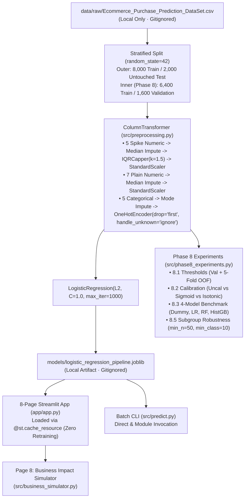

# ShopSmart — Technical Walkthrough (ML Engineering Perspective)

This document explains ShopSmart's end-to-end engineering design grounded directly in `src/`, `app/`, and `tests/`.

---

## 1. End-to-End Architecture

---

## 2. Data Pipeline & Feature Processing (`src/config.py`, `src/preprocessing.py`)

- **Identifiers & Target:** `Customer_ID` (`ID_COL`) is dropped before modeling; `Purchase` (`TARGET_COL`) is never passed into `ColumnTransformer`.
- **Custom Leak-Free `IQRCapper`:** Inherits from `BaseEstimator, TransformerMixin`. `fit()` learns `[Q1 - k*IQR, Q3 + k*IQR]` strictly on training-fold values; `transform()` clips out-of-sample data to those frozen bounds.
- **Transformed Space:** `17` raw inputs (`12` numeric + `5` categorical) expand cleanly into `26` transformed features (`12` scaled numeric + `14` one-hot reference-dropped indicators).
- **Unknown Categories & Nulls:** `SimpleImputer` handles missing numeric/categorical values using training medians/modes; `OneHotEncoder(handle_unknown="ignore")` encodes unseen categories as all-zero indicator vectors without crashing.

---

## 3. Training & Validation Methodology (`src/train_pipeline.py`, `src/phase8_experiments.py`)

- **Historical Baseline (`src/train_pipeline.py`):** 80/20 stratified split (`8,000 / 2,000`, `random_state=42`), 5-fold stratified CV (`ROC-AUC = 0.7281 ± 0.0071`), empirical IQR ablation (`k=1.5` improves Test ROC-AUC by `+0.0339` over uncapped raw), and prediction-time leakage audit (`Payment_Method` removal `-0.0002`; cart-stage removal `-0.0714`).
- **Phase 8 Leakage-Safe Protocol (`src/phase8_experiments.py`):** Preserves the exact `2,000`-row final test split untouched while partitioning the `8,000` training rows into `6,400` inner train and `1,600` validation. Thresholds, calibration methods, and model hyperparameters are selected strictly on validation (`X_val`) and evaluated once on `X_test`.

---

## 4. Prediction Flow, Threshold Logic & Calibration

- **Single & Batch Inference (`app/utils.py`, `src/predict.py`):** Loads the saved `.joblib` pipeline via `@st.cache_resource` (never calls `.fit()`). Validates required columns, numeric coercibility, missing values, unseen categories, duplicate IDs, and warns/ignores target columns (`Purchase` / `Actual_Purchase`). Uploaded batch CSVs are scored **strictly in memory** and never written to disk.
- **Calibration Analysis:** Compares uncalibrated LR vs. 5-fold Sigmoid vs. 5-fold Isotonic using Brier score, Log-loss, 10-bin uniform ECE, and logistic recalibration slope/intercept. Uncalibrated LR won on validation (`Val Brier = 0.1931`, `Slope = 1.0098`) and untouched test (`Test Brier = 0.1903`, `ECE = 0.0236`).

---

## 5. Business Impact Simulator Calculation Flow (`src/business_simulator.py`)

1. **Input Validation:** Rejects negative budgets/costs, non-positive AOV, invalid margins (`<=0` or `>100`), invalid uplift/effectiveness, or out-of-range thresholds (`[0.05, 0.95]`).
2. **Targeting & Budget Cap:** Computes model-qualified share above `decision_threshold`, scales to `available_customers`, and caps selected customers at `floor(budget / cost_per_customer)` when budget-constrained (prioritizing highest-probability sessions first).
3. **Derived Economics:**
   - `baseline_conversions = customers_selected * mean_predicted_prob_targeted`
   - `incremental_conversions = min(customers_selected * effective_uplift, customers_selected - baseline_conversions)`
   - `incremental_gross_profit = incremental_conversions * aov * margin_rate`
   - `net_incremental_profit = incremental_gross_profit - campaign_expenditure`
   - `breakeven_uplift_pct = (cost_per_customer / (aov * margin_rate)) * 100`
4. **Epistemic Boundary:** Clearly separates observed probabilities from user-defined uplift assumptions requiring randomized A/B testing.

---

## 6. Testing & Data Governance (`tests/`, `.gitignore`, `DATA_PROVENANCE.md`)

- **`16` Automated Tests (`pytest tests/ -v`):** Covers schema balance, `IQRCapper` no-leakage, pipeline determinism, batch validation edge cases, leakage-safe thresholding, calibration metrics, 4-model comparison integrity, simulator math & zero/negative/extreme edge cases, subgroup `min_n=50` suppression, empty-filter UX, and all `8` Streamlit pages via `AppTest`.
- **Governance:** `.gitignore` excludes `data/raw/*.csv`, `outputs/*.csv`, `models/*.joblib`, `.venv/`, and caches so zero raw customer records or credentials reach GitHub.
