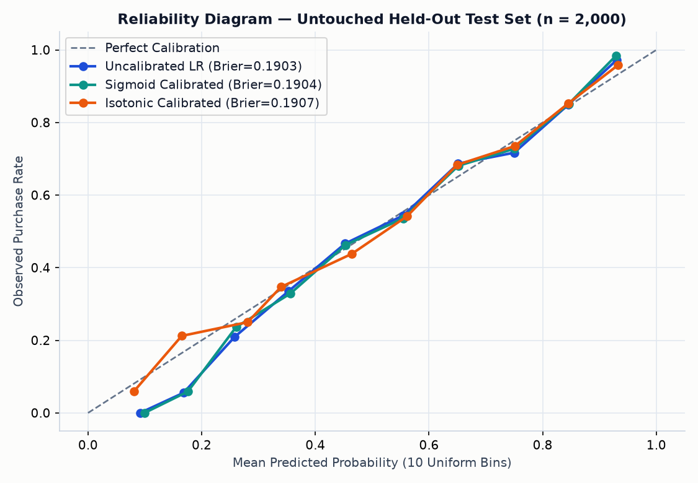
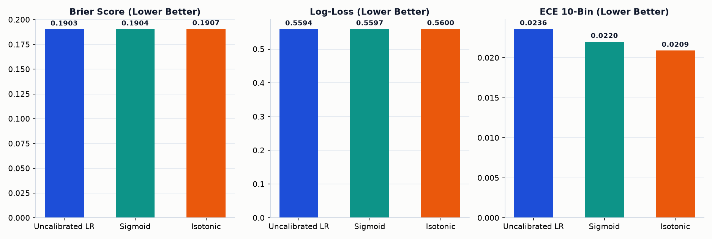

# PHASE 8.2 — PROBABILITY CALIBRATION REPORT
## ShopSmart — E-Commerce Customer Purchase Prediction

**Evaluation Date:** 2026-11-21  
**Visualizations:** `outputs/phase8/calibration/` (`01_reliability_diagram.png`, `02_calibration_comparison.png`, `03_probability_distribution.png`, `04_calibration_error_by_band.png`)  
**Machine-Readable Evidence:** `outputs/phase8/phase8_summary.json`

---

## 1. Why Calibration Matters for Marketing Decisions

A model with strong ranking power (ROC-AUC) can still produce distorted probability estimates. In ShopSmart, predicted probabilities drive:
- **Probability-tiered marketing segments** (`High Intent >= 0.75`, `Medium 0.50–0.74`, etc.),
- **Expected baseline conversion forecasts** in the Business Impact Simulator, and
- **Budget-constrained threshold selection**.

Overconfident probabilities inflate forecasted baseline conversions and distort campaign ROI projections.

---

## 2. Leakage-Safe Calibration Methodology

Three probability estimators were compared using strictly leakage-safe procedures (`random_state = 42`):
1. **Uncalibrated L2 Logistic Regression (`C = 1.0`)** — fit on `X_tr` (`6,400`).
2. **Sigmoid (Platt) Calibration** — `CalibratedClassifierCV(method="sigmoid", cv=5)` fit strictly on `X_tr` (`6,400`).
3. **Isotonic Calibration** — `CalibratedClassifierCV(method="isotonic", cv=5)` fit strictly on `X_tr` (`6,400`; `n = 6,400` is sufficient to test non-parametric monotonic calibration while watching for overfitting).

- **Binning Choice for ECE:** Expected Calibration Error (`ECE`) is computed across **`10` uniform-width probability bins** (`[0.0, 0.1), ..., [0.9, 1.0]`), weighted by bin sample share.
- **Selection Rule:** Select the calibration method strictly on **Validation (`X_val`, `n = 1,600`)** Brier score, Log-loss, and ECE before evaluating on the untouched test set (`X_test`, `n = 2,000`).

---

## 3. Validation Comparison (Model Selection Split, `n = 1,600`)

| Method | Val Brier | Val Log-Loss | Val ECE (10-Bin) | Val Cal. Intercept | Val Cal. Slope | Val ROC-AUC | Val PR-AUC |
|---|---:|---:|---:|---:|---:|---:|---:|
| **Uncalibrated Logistic Regression (Selected)** | **`0.1931`** | **`0.5672`** | `0.0208` | `-0.0249` | **`1.0098`** | `0.7355` | `0.8313` |
| Sigmoid Calibration (`cv=5`) | `0.1931` | `0.5673` | `0.0196` | `-0.0456` | `1.0495` | `0.7356` | `0.8314` |
| Isotonic Calibration (`cv=5`) | `0.1941` | `0.5703` | `0.0310` | `0.0121` | `0.9372` | `0.7350` | `0.8301` |

**Validation Decision:** **Uncalibrated Logistic Regression** is selected. Its validation calibration slope (`1.0098`, near ideal `1.0`), intercept (`-0.0249`, near ideal `0.0`), Brier (`0.1931`), and Log-Loss (`0.5672`) are already optimal. Isotonic calibration slightly overfits (`Val ECE` worsens from `0.0208` to `0.0310` and `Log-Loss` rises to `0.5703`).

---

## 4. Untouched Final Test Results (`n = 2,000`, Refit on `8,000` Train Rows)

| Method | Test Brier | Test Log-Loss | Test ECE (10-Bin) | Test Cal. Intercept | Test Cal. Slope | Test ROC-AUC | Test PR-AUC |
|---|---:|---:|---:|---:|---:|---:|---:|
| **Uncalibrated Logistic Regression (Selected)** | **`0.1903`** | **`0.5594`** | `0.0236` | `-0.0476` | `1.0894` | **`0.7411`** | **`0.8388`** |
| Sigmoid Calibration (`cv=5`) | `0.1904` | `0.5597` | `0.0220` | `-0.0648` | `1.1224` | `0.7411` | `0.8388` |
| Isotonic Calibration (`cv=5`) | `0.1907` | `0.5600` | `0.0209` | `-0.0285` | `1.0480` | `0.7405` | `0.8370` |

### Key Findings
- **Strong Native Calibration:** Across the core populated decision bands (`0.30–0.90`, covering `1,774 / 2,000` test sessions), uncalibrated Logistic Regression's absolute band error stays between **`0.41%` and `3.55%`**.
- **Tail Caution:** Very sparse low-probability bands (`0.0–0.2`, only `19` total test rows) exhibit higher sampling variance (`abs_error ~ 0.09–0.11`).
- **Conclusion:** Retaining the native Logistic Regression pipeline preserves exact standardized odds-ratio interpretability without sacrificing probability reliability.

