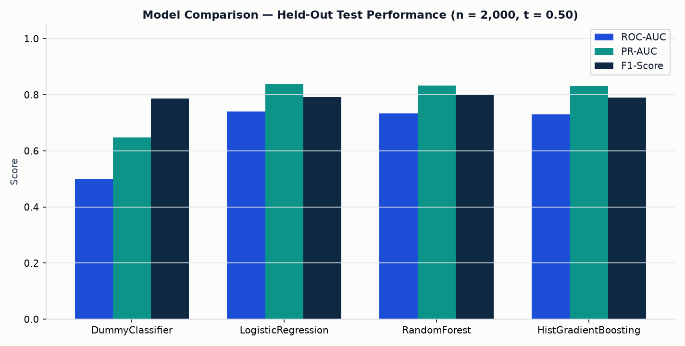
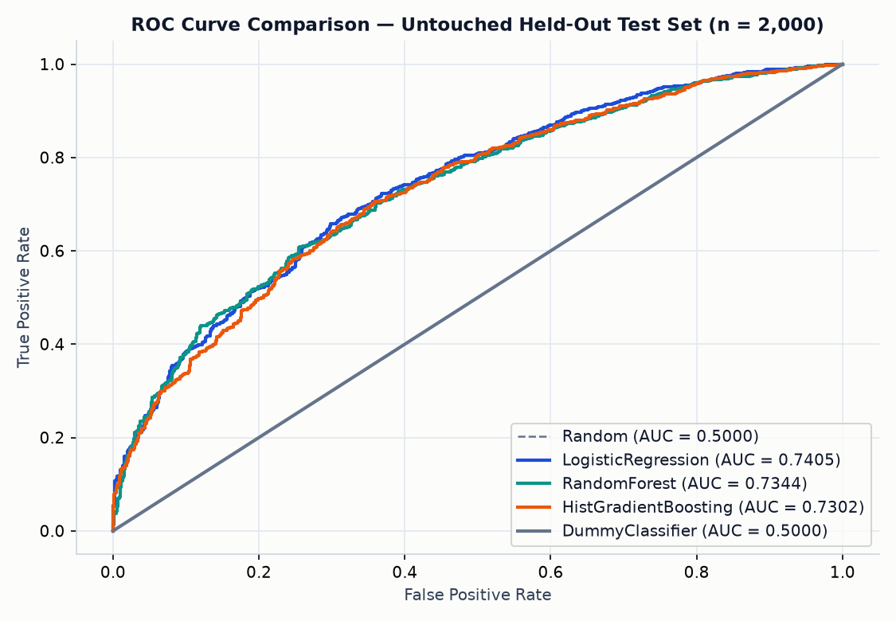

# PHASE 8.3 — COMPARATIVE MACHINE-LEARNING MODEL REPORT
## ShopSmart — E-Commerce Customer Purchase Prediction

**Evaluation Date:** 2026-11-21  
**Comparison Table:** `outputs/phase8/model_comparison/model_comparison.csv`  
**Visualizations:** `outputs/phase8/model_comparison/` (`01_model_comparison_bar.png`, `02_roc_curve_comparison.png`, `03_pr_curve_comparison.png`, `04_metric_comparison_heatmap.png`)

---

## 1. Experimental Protocol

Four model families were benchmarked on identical stratified splits (`X_tr = 6,400`, `X_val = 1,600`, untouched `X_test = 2,000`, `random_state = 42`), with all preprocessing fit strictly inside the training partition:

1. **DummyClassifier (`strategy="prior"`):** Non-informative base-rate benchmark.
2. **LogisticRegression (L2 + IQR `k=1.5`):** Controlled validation grid over `C in {0.1, 1.0, 5.0}`.
3. **RandomForestClassifier (`n_estimators=200`):** Controlled validation grid over `max_depth in {6, 10}`, `min_samples_leaf in {5, 15}`.
4. **HistGradientBoostingClassifier (`max_iter=200`, `l2=1.0`):** Controlled validation grid over `max_depth in {3, 5}`, `learning_rate in {0.05, 0.1}`.

---

## 2. Comparative Results (Untouched Held-Out Test Set, `n = 2,000`, `t = 0.50`)

| Model | Val-Selected Config | Val ROC-AUC | Test ROC-AUC | Test PR-AUC | Test Prec | Test Rec | Test F1 | Test Acc | Test Log-Loss | Test Brier | Test ECE | Inference (2k rows) | Complexity / Interpretability |
|---|---|---:|---:|---:|---:|---:|---:|---:|---:|---:|---:|---:|---|
| **DummyClassifier** | `strategy=prior` | `0.5000` | `0.5000` | `0.6480` | `0.6480` | `1.0000` | `0.7864` | `0.6480` | `0.6487` | `0.2281` | `0.0000` | `13.12 ms` | Trivial / Baseline only |
| **LogisticRegression** | `C=0.1` *(hist. `C=1.0`: `0.7411`)* | **`0.7357`** | **`0.7405`** | **`0.8384`** | **`0.7256`** | `0.8711` | `0.7917` | **`0.7030`** | **`0.5599`** | **`0.1905`** | `0.0240` | **`15.52 ms`** | Low (26 weights) / High (Odds Ratios) |
| **RandomForest** | `depth=10, leaf=5` | `0.7147` | `0.7344` | `0.8329` | `0.6951` | `0.9429` | **`0.8003`** | `0.6950` | `0.5815` | `0.1984` | `0.0603` | `66.10 ms` | High (200 trees) / Medium-Low |
| **HistGradientBoosting** | `depth=3, lr=0.05` | `0.7153` | `0.7302` | `0.8311` | `0.7154` | `0.8804` | `0.7893` | `0.6955` | `0.5699` | `0.1943` | `0.0218` | `17.10 ms` | Medium-High / Low (Needs SHAP) |

---

## 3. Model Selection Decision & Suitability Assessment

**Final Selected Architecture:** **L2-Regularized Logistic Regression** (preserving the validated `C = 1.0` production artifact, `Test ROC-AUC = 0.7411`, `Brier = 0.1903`; validation-tuned `C = 0.1` performs nearly identically at `0.7405` / `0.1905`).

### Why Complex Tree/Boosting Models Are Not Selected Here
- **RandomForest (`Test ROC-AUC = 0.7344`):** Underperforms Logistic Regression on ROC-AUC (`-0.0061`), PR-AUC (`-0.0055`), Log-Loss (`+0.0216`), Brier (`+0.0079`), and calibration (`ECE = 0.0603`, 2.5× worse calibration error), while running **4.3× slower** at inference (`66.10 ms` vs. `15.52 ms`). Its slightly higher F1 at `t = 0.50` (`0.8003`) is purely a threshold-shift artifact from predicting positive on more sessions (`Recall = 0.9429`, `Precision = 0.6951`).
- **HistGradientBoosting (`Test ROC-AUC = 0.7302`):** Underperforms Logistic Regression across ROC-AUC (`-0.0103`), PR-AUC (`-0.0073`), Accuracy (`-0.0075`), Log-Loss (`+0.0100`), and Brier (`+0.0038`), while sacrificing direct odds-ratio transparency.
- **DummyClassifier (`Test ROC-AUC = 0.5000`):** Confirms the `0.6480` majority-class baseline (`Brier = 0.2281`); unsuitable for targeting.

**Conclusion:** After IQR Winsorisation removes extreme right-tail spikes, the purchase-intent signal in this dataset is predominantly additive in log-odds. Logistic Regression delivers the strongest discrimination, best probability calibration, fastest inference, and clearest stakeholder interpretability.

