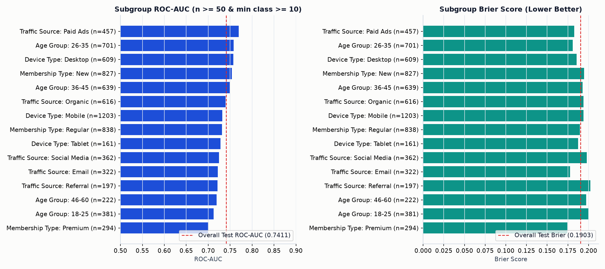
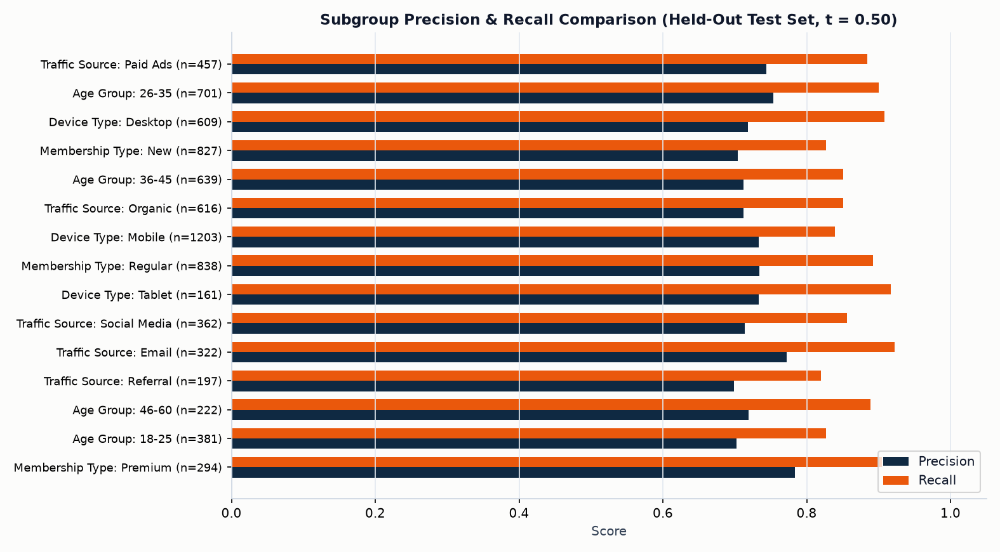

# PHASE 8.5 — SUBGROUP & ROBUSTNESS ANALYSIS REPORT
## ShopSmart — E-Commerce Customer Purchase Prediction

**Evaluation Date:** 2026-11-21  
**Subgroup Table:** `outputs/phase8/robustness/subgroup_metrics.csv`  
**Visualizations:** `outputs/phase8/robustness/` (`01_subgroup_roc_brier.png`, `02_subgroup_precision_recall.png`)

---

## 1. Minimum Sample-Size Guardrails

To avoid publishing noisy or misleading discrimination metrics on tiny slices, strict minimum-sample rules were enforced on the held-out test set (`n = 2,000`, `t = 0.50`):
- **Minimum total subgroup size:** `n >= 50`
- **Minimum positive & negative class counts:** `pos >= 10` and `neg >= 10`

**Flagged & Suppressed Small Subgroups (`5` slices):**
- `Age Group: 60+` (`n = 13 < 50`)
- `Device Type: Missing` (`n = 27 < 50`)
- `Membership Type: Missing` (`n = 41 < 50`)
- `Age Group: Missing` (`n = 44 < 50`)
- `Traffic Source: Missing` (`n = 46 < 50`)

Ranking and calibration metrics were intentionally suppressed (`None`) for these 5 slices rather than displaying statistically unreliable estimates.

---

## 2. Subgroup Performance Summary (Valid Slices `n >= 50`)

| Dimension | Subgroup | Sample `n` | Positive Rate | Precision | Recall | F1 | ROC-AUC | PR-AUC | Brier |
|---|---|---:|---:|---:|---:|---:|---:|---:|---:|
| **Device Type** | Desktop | `609` | `64.53%` | `0.7183` | `0.9084` | `0.8022` | `0.7573` | `0.8477` | `0.1857` |
| **Device Type** | Mobile | `1,203` | `64.67%` | `0.7329` | `0.8393` | `0.7825` | `0.7321` | `0.8299` | `0.1939` |
| **Device Type** | Tablet | `161` | `67.08%` | `0.7333` | `0.9167` | `0.8148` | `0.7280` | `0.8594` | `0.1875` |
| **Membership** | New | `827` | `59.98%` | `0.7045` | `0.8266` | `0.7607` | `0.7538` | `0.8207` | `0.1947` |
| **Membership** | Regular | `838` | `66.59%` | `0.7345` | `0.8925` | `0.8058` | `0.7315` | `0.8412` | `0.1896` |
| **Membership** | Premium | `294` | `74.83%` | `0.7835` | `0.9045` | `0.8397` | `0.7007` | `0.8768` | `0.1743` |
| **Traffic Source** | Paid Ads | `457` | `64.55%` | `0.7436` | `0.8847` | `0.8080` | `0.7693` | `0.8574` | `0.1827` |
| **Traffic Source** | Organic | `616` | `63.15%` | `0.7118` | `0.8509` | `0.7752` | `0.7395` | `0.8311` | `0.1938` |
| **Traffic Source** | Social Media | `362` | `63.54%` | `0.7138` | `0.8565` | `0.7787` | `0.7249` | `0.8179` | `0.1979` |
| **Traffic Source** | Email | `322` | `72.05%` | `0.7726` | `0.9224` | `0.8409` | `0.7218` | `0.8729` | `0.1775` |
| **Traffic Source** | Referral | `197` | `61.93%` | `0.6993` | `0.8197` | `0.7547` | `0.7214` | `0.7978` | `0.2021` |
| **Age Group** | 18–25 | `381` | `63.78%` | `0.7028` | `0.8272` | `0.7599` | `0.7121` | `0.8203` | `0.2001` |
| **Age Group** | 26–35 | `701` | `66.90%` | `0.7536` | `0.8998` | `0.8202` | `0.7579` | `0.8520` | `0.1808` |
| **Age Group** | 36–45 | `639` | `62.75%` | `0.7119` | `0.8504` | `0.7750` | `0.7494` | `0.8386` | `0.1928` |
| **Age Group** | 46–60 | `222` | `64.86%` | `0.7191` | `0.8889` | `0.7950` | `0.7192` | `0.8288` | `0.1973` |

### Target-Class Error Breakdown (`t = 0.50`)
- **`Purchase (1)` (`n = 1,296`):** Class accuracy (Recall) = **`86.88%`**, Mean squared probability error (Brier) = **`0.1142`**.
- **`No Purchase (0)` (`n = 704`):** Class accuracy (Specificity) = **`40.20%`**, Mean squared probability error (Brier) = **`0.3304`**.

---

## 3. Error Pattern Observations & Responsible-Use Disclosure

1. **Consistent Across Major Cohorts:** Across all `15` valid subgroups (`n >= 50`), ROC-AUC stays in a tight band (`0.7007–0.7693`) and Brier score stays between `0.1743` and `0.2021`.
2. **Notable Segment Differences:**
   - **Desktop vs. Mobile:** Desktop (`ROC-AUC = 0.7573`, `Recall = 90.84%`) has higher recall and discrimination than Mobile (`ROC-AUC = 0.7321`, `Recall = 83.93%`), reflecting Mobile's lower baseline log-odds (`OR = 0.80`) and higher abandonment noise.
   - **Premium vs. New:** Premium members show lower ROC-AUC (`0.7007`) yet the best Brier score (`0.1743`) and highest PR-AUC (`0.8768`), because most Premium cart sessions convert (`74.83%`), compressing ranking separation while keeping probabilities accurate.
   - **Class Asymmetry:** At `t = 0.50`, false positives on non-buyers (`59.80%` FP rate) are the primary error mode. Raising the threshold (e.g., `t = 0.67`) substantially improves non-buyer specificity (`514 / 704 = 73.01%`).
3. **No Unsupported Fairness Claims:** This analysis measures offline subgroup error stability only. It does **not** certify fairness or eliminate demographic/behavioral bias; ongoing production monitoring is required.

