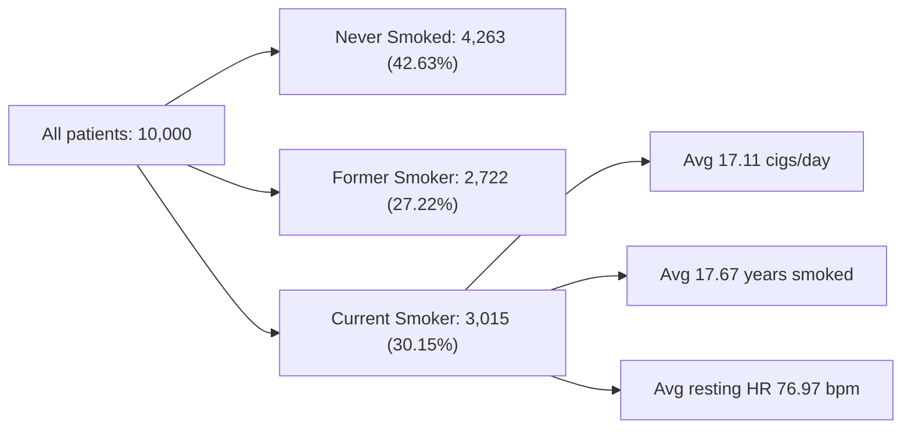
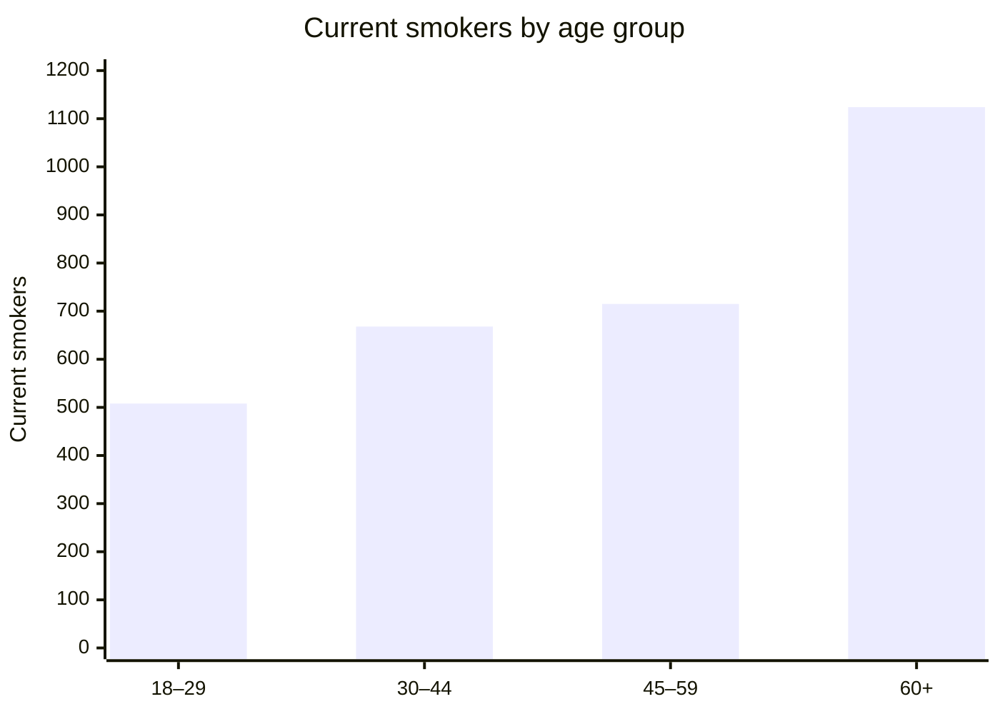

# Smoking and Health Analysis Dashboard — Technical Specification & Analytical Report

**Domain:** Healthcare Analytics  
**Tool:** Microsoft Power BI (PBIP project)  
**Prepared for:** Management team, Sapphire IQ  
**Author / role:** Ricky, Health Data Analyst  
**Data source:** `Smoking_Health_Analysis.csv` (10,000 patient records, 15 columns, no missing values, no duplicate Patient_IDs)  
**Disclaimer:** *This report and the accompanying dashboard are for educational and exploratory analysis. They do not establish medical diagnoses or show that smoking causes any specific health condition.*

---

## 1. Executive summary

Management asked for a view of patients' smoking habits, recorded health conditions, and key indicators such as cholesterol and blood pressure. The dashboard answers this with four KPI cards, two calculated columns and six analysis visuals across two pages, filterable by gender, region and smoking status.

**Headline numbers**

- **10,000 patients** across five regions (North, West, South, East, Central).
- **3,015 current smokers (30.15%)**, 2,722 former smokers (27.22%), 4,263 never smoked (42.63%). Ever-smoked: 5,737 (57.37%).
- **7,227 patients (72.27%)** have a recorded organ category and **5,772 (57.72%)** have a recorded health condition.
- Current smokers average **17.11 cigarettes/day** and **17.67 years** of smoking.
- **60.49%** of patients fall in the *High* blood-pressure category (thresholds in section 3.2).

**What the data does and does not show**

- Smoking prevalence is similar across age groups, regions and female/male patients (roughly 29–32%; the small *Other* gender group is lower at 24.3%). The 60+ group holds the most current smokers (1,124) simply because it is the largest age group.
- Patients' recorded-condition rate does **not** differ meaningfully by smoking status (57.4% current, 56.9% former, 58.4% never; chi-square p = 0.45), and does not rise with estimated smoking exposure (section 5.2).
- Current smokers have a slightly higher resting heart rate (77.0 vs 74.0 bpm for never-smokers) and High-BP patients a slightly higher average cholesterol, but both gaps are small.
- These are descriptive, cross-sectional results. They are useful for monitoring and for deciding where to look next, not for drawing causal conclusions.



---

## 2. Objective 1 — Overall patient health KPIs

| KPI | Metric | Value | % of patients | Definition |
| :---: | :--- | ---: | ---: | :--- |
| 1 | Total Patients | 10,000 | 100.00% | Row count of the patient table (Patient_ID is unique) |
| 2 | Total Current Smokers | 3,015 | 30.15% | `Smoking_Status = "Current Smoker"` |
| 3 | Patients with Recorded Organ | 7,227 | 72.27% | `Diagnosed_Organ <> "No Recorded Organ Condition"` |
| 4 | Patients with Recorded Condition | 5,772 | 57.72% | `Health_Condition <> "No Diagnosed Condition"` |

KPI 3 and KPI 4 are measured separately and are not nested: 2,692 patients have a recorded organ but *No Diagnosed Condition*, and 1,237 patients have a condition (Hypertension, High Cholesterol or Type 2 Diabetes) but *No Recorded Organ Condition*.

```dax
Total Patients = COUNTROWS('Smoking_Health_Analysis')

Total Current Smokers =
CALCULATE(
    COUNTROWS('Smoking_Health_Analysis'),
    'Smoking_Health_Analysis'[Smoking_Status] = "Current Smoker"
)

Patients with Recorded Organ =
CALCULATE(
    COUNTROWS('Smoking_Health_Analysis'),
    'Smoking_Health_Analysis'[Diagnosed_Organ] <> "No Recorded Organ Condition"
)

Patients with Recorded Condition =
CALCULATE(
    COUNTROWS('Smoking_Health_Analysis'),
    'Smoking_Health_Analysis'[Health_Condition] <> "No Diagnosed Condition"
)

Smoker Prevalence Rate = DIVIDE([Total Current Smokers], [Total Patients], 0)
```

---

## 3. Objective 2 — Calculated columns (DAX)

### 3.1 Age Group

Ages in the data run from 18 to 85. Brackets: 18–29, 30–44, 45–59, 60+.

```dax
Age Group =
SWITCH(
    TRUE(),
    'Smoking_Health_Analysis'[Age] < 30, "18–29",
    'Smoking_Health_Analysis'[Age] < 45, "30–44",
    'Smoking_Health_Analysis'[Age] < 60, "45–59",
    "60+"
)

Age Group Sort =
SWITCH(
    TRUE(),
    'Smoking_Health_Analysis'[Age] < 30, 1,
    'Smoking_Health_Analysis'[Age] < 45, 2,
    'Smoking_Health_Analysis'[Age] < 60, 3,
    4
)
```

`Age Group` is set to *Sort by column* `Age Group Sort` so the brackets display in natural order.

### 3.2 BP Risk Category

The brief asks for Lower Range, Elevated and High categories but does not give numeric cut-offs. The model uses an AHA/ACC-style rule:

- **High:** systolic ≥ 130 **or** diastolic ≥ 80
- **Elevated:** systolic 120–129 **and** diastolic < 80
- **Lower Range:** everything else (systolic < 120 and diastolic < 80)

```dax
BP Risk Category =
SWITCH(
    TRUE(),
    'Smoking_Health_Analysis'[Systolic_BP_mmHg] >= 130 || 'Smoking_Health_Analysis'[Diastolic_BP_mmHg] >= 80, "High",
    'Smoking_Health_Analysis'[Systolic_BP_mmHg] >= 120 && 'Smoking_Health_Analysis'[Diastolic_BP_mmHg] < 80, "Elevated",
    "Lower Range"
)

BP Risk Sort =
SWITCH(
    TRUE(),
    'Smoking_Health_Analysis'[Systolic_BP_mmHg] >= 130 || 'Smoking_Health_Analysis'[Diastolic_BP_mmHg] >= 80, 3,
    'Smoking_Health_Analysis'[Systolic_BP_mmHg] >= 120 && 'Smoking_Health_Analysis'[Diastolic_BP_mmHg] < 80, 2,
    1
)
```

Because the cut-offs are an assumption, the choice was tested. Under a looser rule (High ≥ 140/90; Elevated 120–139 or 80–89) the split changes to High 2,447, Elevated 5,053, Lower Range 2,500, but the cholesterol ordering is unchanged (195.35 < 197.18 < 197.87 mg/dL).

### 3.3 Supporting columns for Objective 4.2

```dax
Pack Years =
('Smoking_Health_Analysis'[Cigarettes_Per_Day] / 20) * 'Smoking_Health_Analysis'[Years_Smoking]

Exposure Category =
SWITCH(
    TRUE(),
    'Smoking_Health_Analysis'[Smoking_Status] = "Never Smoked", "Never Smoked",
    'Smoking_Health_Analysis'[Pack Years] = 0, "Former Smokers (0 Current PY)",
    'Smoking_Health_Analysis'[Pack Years] < 10, "Light (<10 Pack-Years)",
    'Smoking_Health_Analysis'[Pack Years] < 20, "Moderate (10–19.9 Pack-Years)",
    "Heavy (20+ Pack-Years)"
)
```

`Exposure Sort` (1–5) orders the tiers from Never Smoked to Heavy.

---

## 4. Objective 3 — Smoking patterns and health indicators

### 4.1 Average cigarettes per day by smoking status

| Smoking status | Patients | % of patients | Avg cigarettes/day | Min | Max | Std dev |
| :--- | ---: | ---: | ---: | ---: | ---: | ---: |
| **Current Smoker** | 3,015 | 30.15% | 17.11 | 1 | 45 | 10.78 |
| **Former Smoker** | 2,722 | 27.22% | 0.00 | 0 | 0 | 0.00 |
| **Never Smoked** | 4,263 | 42.63% | 0.00 | 0 | 0 | 0.00 |
| **All patients** | 10,000 | 100.00% | 5.16 | 0 | 45 | 9.83 |

```dax
Average Cigarettes Per Day = AVERAGE('Smoking_Health_Analysis'[Cigarettes_Per_Day])
```

Former and Never smokers record 0 cigarettes/day, so only the Current Smoker bar is non-zero (**17.11**). Former smokers did smoke for 16.18 years on average (range 1–49), but their past intensity is not recorded.

### 4.2 Organ-wise health condition distribution

The registry has five organ designations and 16 distinct condition labels.

| Diagnosed organ | Patients | % of all patients | Health condition | Patients | % within organ |
| :--- | ---: | ---: | :--- | ---: | ---: |
| **Lungs** | 2,792 | 27.92% | No Diagnosed Condition | 836 | 29.94% |
|  |  |  | COPD | 717 | 25.68% |
|  |  |  | Reduced Lung Function | 689 | 24.68% |
|  |  |  | Asthma | 550 | 19.70% |
| **Heart** | 2,197 | 21.97% | No Diagnosed Condition | 979 | 44.56% |
|  |  |  | Coronary Artery Disease | 530 | 24.12% |
|  |  |  | Arrhythmia | 403 | 18.34% |
|  |  |  | Heart Failure | 285 | 12.97% |
| **Liver** | 1,231 | 12.31% | No Diagnosed Condition | 462 | 37.53% |
|  |  |  | Fatty Liver | 409 | 33.23% |
|  |  |  | Liver Inflammation | 234 | 19.01% |
|  |  |  | Reduced Liver Function | 126 | 10.24% |
| **Kidneys** | 1,007 | 10.07% | No Diagnosed Condition | 415 | 41.21% |
|  |  |  | Reduced Kidney Function | 252 | 25.02% |
|  |  |  | Chronic Kidney Disease | 199 | 19.76% |
|  |  |  | Kidney Stones | 141 | 14.00% |
| **No Recorded Organ Condition** | 2,773 | 27.73% | No Diagnosed Condition | 1,536 | 55.39% |
|  |  |  | Hypertension | 494 | 17.81% |
|  |  |  | High Cholesterol | 476 | 17.17% |
|  |  |  | Type 2 Diabetes | 267 | 9.63% |

Lungs and Heart together account for 4,989 patients — 49.9% of all patients, or 69.0% of patients with a recorded organ.

### 4.3 Smoking status distribution

| Smoking status | Patients | % of all patients |
| :--- | ---: | ---: |
| Never Smoked | 4,263 | 42.63% |
| Current Smoker | 3,015 | 30.15% |
| Former Smoker | 2,722 | 27.22% |

### 4.4 Average cholesterol across BP risk categories

| BP risk category | Patients | % of patients | Avg total cholesterol (mg/dL) | Median | Min | Max |
| :--- | ---: | ---: | ---: | ---: | ---: | ---: |
| **Lower Range** | 2,500 | 25.00% | **195.35** | 196 | 110 | 329 |
| **Elevated** | 1,451 | 14.51% | **195.73** | 196 | 110 | 325 |
| **High** | 6,049 | 60.49% | **197.81** | 198 | 110 | 314 |
| **All patients** | 10,000 | 100.00% | **196.89** | 197 | 110 | 329 |

```dax
Average Total Cholesterol = AVERAGE('Smoking_Health_Analysis'[Total_Cholesterol_mg_dL])
```

Average cholesterol rises from 195.35 (Lower Range) to 195.73 (Elevated) to 197.81 mg/dL (High). The gap between High and Lower Range is about 2.5 mg/dL, roughly 0.08 standard deviations. It is statistically detectable with this many patients (one-way ANOVA p = 0.002) but small in practical terms, and every category spans the full cholesterol range. Treat it as a weak pattern worth monitoring, not a strong relationship.

---

## 5. Objective 4 — Demographics and health patterns

### 5.1 Current smokers across age groups

| Age group | Patients | Current smokers | Prevalence within group | Share of all current smokers |
| :--- | ---: | ---: | ---: | ---: |
| **18–29** | 1,774 | 508 | 28.64% | 16.85% |
| **30–44** | 2,213 | 668 | 30.19% | 22.16% |
| **45–59** | 2,279 | 715 | 31.37% | 23.71% |
| **60+** | 3,734 | 1,124 | 30.10% | 37.28% |
| **Total** | 10,000 | 3,015 | 30.15% | 100.00% |



Prevalence is 28.6–31.4% in every age group. The 60+ group has the most current smokers because it is the largest group (37.3% of patients), not because its prevalence is higher.

Supplementary breakdowns (available through the dashboard slicers):

| Gender | Patients | Current smokers | Prevalence |
| :--- | ---: | ---: | ---: |
| Female | 4,769 | 1,445 | 30.30% |
| Male | 5,042 | 1,524 | 30.23% |
| Other | 189 | 46 | 24.34% |

| Region | Patients | Current smokers | Prevalence |
| :--- | ---: | ---: | ---: |
| Central | 1,609 | 518 | 32.19% |
| East | 1,746 | 531 | 30.41% |
| North | 2,400 | 721 | 30.04% |
| South | 1,971 | 573 | 29.07% |
| West | 2,274 | 672 | 29.55% |

The *Other* gender group is small (189 patients), so its prevalence is less reliable.

### 5.2 Recorded health conditions across estimated smoking exposure

Exposure is estimated as pack-years, `(Cigarettes_Per_Day / 20) × Years_Smoking`, and grouped into the tiers below.

| Exposure tier | Patients in tier | With a diagnosed condition | % with a condition | Top 3 conditions (excl. none) |
| :--- | ---: | ---: | ---: | :--- |
| **Never Smoked** | 4,263 | 2,490 | 58.41% | Reduced Lung Function (301), COPD (298), Asthma (245) |
| **Former Smokers (0 Current PY)** | 2,722 | 1,550 | 56.94% | COPD (202), Reduced Lung Function (188), Coronary Artery Disease (147) |
| **Light (<10 Pack-Years)** | 1,562 | 921 | 58.96% | COPD (124), Reduced Lung Function (103), Asthma (93) |
| **Moderate (10–19.9 Pack-Years)** | 706 | 408 | 57.79% | COPD (52), Reduced Lung Function (50), Coronary Artery Disease (41) |
| **Heavy (20+ Pack-Years)** | 747 | 403 | 53.95% | Reduced Lung Function (47), Coronary Artery Disease (45), COPD (41) |

**No dose-response pattern.** The share of patients with a recorded condition is 58.4% for never-smokers and 53.9% for the heaviest tier — if anything lower, not higher. By smoking status the rates are also similar:

| Smoking status | Patients | % with a recorded condition | % with a recorded organ |
| :--- | ---: | ---: | ---: |
| Current Smoker | 3,015 | 57.45% | 71.81% |
| Former Smoker | 2,722 | 56.94% | 71.97% |
| Never Smoked | 4,263 | 58.41% | 72.79% |

The differences are not statistically significant (chi-square p = 0.45). Duration of smoking shows the same absence of a gradient:

| Years smoked (current + former smokers) | Patients | % with a recorded condition |
| :--- | ---: | ---: |
| 1–10 yrs | 2,373 | 58.32% |
| 11–20 yrs | 1,402 | 57.70% |
| 21–30 yrs | 893 | 57.45% |
| 31+ yrs | 1,069 | 53.88% |

**The "Former Smokers (0 Current PY)" tier is a placeholder, not zero exposure.** Former smokers have 0 cigarettes/day recorded, so pack-years cannot be estimated for them even though they smoked for 16.2 years on average. Their tier means "past intensity unknown".

---

## 6. Dashboard design (as built)

| Page | Visual | Type | Fields |
| :--- | :--- | :--- | :--- |
| Executive Overview | KPI 1–4 | Card ×4 | Total Patients, Total Current Smokers, Patients with Recorded Organ, Patients with Recorded Condition |
| Executive Overview | Smoking Status Distribution | Pie chart | Smoking_Status, Total Patients |
| Executive Overview | Avg Cigarettes / Day by Status | Bar chart | Smoking_Status, Average Cigarettes Per Day |
| Executive Overview | Avg Cholesterol by BP Risk | Column chart | BP Risk Category, Average Total Cholesterol |
| Detailed Health Analysis | Current Smokers Across Age Groups | Column chart | Age Group, Total Current Smokers |
| Detailed Health Analysis | Organ-Wise Health Condition Cross-Tabulation Matrix | Matrix | Rows: Health_Condition; Columns: Diagnosed_Organ; Values: Total Patients |
| Detailed Health Analysis | Health Condition Distribution by Smoking Exposure (%) | 100% stacked bar | Exposure Category, Health_Condition, Total Patients |

Both pages carry Gender, Region and Smoking Status slicers. Each slicer pair is in a **sync group**, so a selection on one page also applies on the other. The report uses the *Neutral Healthcare Theme* (blue/teal palette on a light background).

---

## 7. Key findings and recommendations

1. **Smoking is common but evenly spread.** 30.15% of patients smoke currently and 57.37% have ever smoked. Prevalence barely varies by age group, region or between female and male patients, so cessation outreach does not need to target one demographic on prevalence grounds. By volume, the 60+ group is the largest pool (1,124 current smokers).
2. **Smoking intensity is high among current smokers.** They average 17.1 cigarettes/day (SD 10.8), a little under a pack (20 cigarettes) a day. This is the clearest smoking-related signal in the dataset.
3. **Heart rate and cholesterol show small differences.** Resting heart rate is about 3.0 bpm higher in current smokers than never-smokers (p < 0.001) and cholesterol is about 2.5 mg/dL higher in the High-BP group. Both are consistent with the usual direction of effect but are too small to act on by themselves.
4. **Recorded conditions do not track smoking in this data.** This is unusual compared with clinical expectations. Before reporting it to management as a finding, confirm with the data owner how conditions were recorded (and whether the data is real or simulated).
5. **Clarify two definitions with the data owner.** 2,692 patients have an organ recorded but no diagnosed condition, and former smokers have no recorded intensity. Both affect how KPI 3, KPI 4 and the exposure chart should be read.
6. **Use the dashboard for monitoring and exploration.** Track the four KPIs over time and use the slicers to compare groups. Do not use it to infer cause and effect.

---

## 8. Data notes and limitations

- Cross-sectional snapshot; no follow-up, so no causal or temporal claims.
- BP cut-offs are an analyst assumption (section 3.2); results were checked against a second rule.
- Pack-years cannot be computed for former smokers (section 5.2).
- Gender *Other* has 189 patients; region and age-group comparisons are more robust.
- Diagnosis dates run from 2021-01-01 to 2026-09-30 and are not used in the current visuals.
- All figures in this report were recomputed from the supplied CSV and match the model's DAX definitions.
