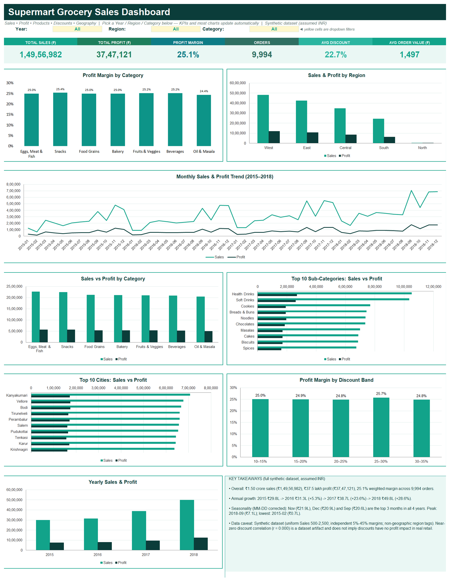

# Supermart Grocery Sales Dashboard

An interactive Microsoft Excel dashboard that analyzes 9,994 synthetic grocery orders (2015–2018) on a single executive view with live dropdown filters for **Year**, **Region**, and **Category**.

> **Portfolio Transparency Notice:** This project uses the public Kaggle **"Supermart Grocery Sales - Retail Analytics Dataset"**, which exhibits clear **synthetic (simulated) generation characteristics** (uniform integer sales of 500–2,500, discrete 5%–45% profit-to-sales ratios generated independently of discounts, and non-geographic region tags). It does **not** represent verified real-world commercial sales records; currency is assumed **INR (₹)** for illustrative purposes.

## Dashboard Preview

## What It Answers

1. **Overall performance:** Total sales, total profit, weighted profit margin (`SUM(Profit) / SUM(Sales)`), order count, average discount, average order value (AOV), annual YoY growth (2015–2018), and 48-month trend.
2. **Category and sub-category performance:** Sales, profit, and profit margin across 7 categories and 23 sub-categories (used as the product proxy since no SKU column exists), with dynamic Top 10 rankings and a `≥ median sales` / `< overall margin` flag.
3. **Discount vs profitability:** Profit margin across 5 discount bands (`10–15%` through `30–35%`) and Pearson correlations between discount, profit, and profit margin.
4. **Geographic distribution:** Sales and profit by Region and Top 10 Cities across Tamil Nadu.

## What the Data Shows (Illustrative Findings)

- **Overall scale (`Dashboard`, `Analysis`):** **₹1.50 crore** in total sales (₹1,49,56,982) and **₹37.5 lakh** in total profit (₹37,47,121), yielding a weighted profit margin of **25.1%** (25.05%) across **9,994 orders** (AOV ₹1,497; average discount 22.7%).
- **Annual growth (`Analysis!A32:E37`):** Sales grew every year, accelerating from **+5.3%** in 2016 (₹31.3L) to **+23.6%** in 2017 (₹38.7L) and **+28.6%** in 2018 (₹49.8L).
- **Seasonality — MM-DD-YYYY verified (`Analysis!A40:C89`):** After correcting 4,042 dash-format dates to month-first (`MM-DD-YYYY`, validated via day-of-month chi-square reduction from `1,105.2` to `32.0`), **November (₹21.9L)**, **December (₹20.9L)**, and **September (₹20.6L)** are consistently the **top 3 months in all four years (2015–2018)**. Peak single month: **2018-09 (₹7.1 lakh / ₹7,05,680)**; lowest month: **2015-02 (₹0.7 lakh / ₹66,030)**.
- **Category balance (`Analysis!A12:F20`):** No category dominates; all 7 categories hold between **13.6%** (`Oil & Masala`) and **15.2%** (`Eggs, Meat & Fish`) of sales, with weighted margins clustered tightly between **24.4%** and **25.4%**.
- **Sub-categories (`Analysis!A92:L116`):** Eight sub-categories meet the `≥ median sales` (₹6.11L) and `< overall margin` (25.05%) flag, led by **Spices (23.8%)**, **Masalas (24.2%)**, and **Cakes (24.6%)**. Because margins are tightly clustered (~24%–26%) and synthetically uniform, these gaps are small.
- **Regions & cities (`Analysis!A23:F29`, `A119:L144`):** **West** accounts for **32.1%** of sales (₹48.0L) and **South** for **16.3%** (₹24.4L; highest margin among major regions at **25.6%**). **North** contains only 1 order (`OD1`, Vellore). Because all 24 Tamil Nadu cities appear under all 4 major regions, Region and City are analyzed as independent views rather than geographic hierarchies.
- **Discounts (`Analysis!A152:H161`):** Pearson correlation is **0.000** with profit (`0.000017`) and **0.008** with profit margin (`0.008282`), with weighted margins between **24.8% and 25.7%** across all 5 discount bands. **Analytical caveat:** This near-zero correlation is a confirmed artifact of the synthetic dataset (profit margins were generated independently of discount) and **cannot** be used to infer how real-world discounting affects retail profit.

## Analytical Recommendations (Methodology & Caveats)

- **Inventory & campaign planning (illustrative):** In a real retail setting displaying this consistent Q3/Q4 surge (September, November, December in all 4 years), align stock replenishment and promotional calendars ahead of September and November peaks.
- **Pricing & margin reviews:** Treat the `≥ median sales` / `< overall margin` sub-category flag (e.g., Spices, Masalas, Cakes) as a screening workflow; in real operations, validate whether margin gaps reflect cost structure, supplier pricing, or sampling noise before repricing.
- **Discounting:** Do **not** assume discounts are margin-neutral based on this dataset's `r = 0.000` synthetic artifact. Real-world discount elasticity requires controlled A/B testing or historical transaction data where realized net price reflects applied discounts.

## Dataset, Provenance & Limitations

- **Source:** 9,994 orders (2015–2018), 7 categories, 23 sub-categories, 24 cities in Tamil Nadu (`Data` sheet, Excel Table `SupermartData`).
- **Synthetic characteristics:** `Sales` consists of uniform integers in `[500, 2500]`; `Profit / Sales` is an exact discrete integer percentage in `{5%..45%}` generated independently of `Discount` (`{10%..35%}`); and all 24 cities appear in all 4 major regions.
- **Currency assumption:** The source dataset does not specify a currency. **INR (₹)** is assumed for illustrative display because all rows list `State = Tamil Nadu`.
- **Date cleaning:** Raw dates contained 5,952 slash-format (`M/D/YYYY`, days 13–31) and 4,042 dash-format (`MM-DD-YYYY`, days 1–12) strings. Full forensic evidence and sensitivity analysis are documented in [Data_Cleaning_Process.md](./Data_Cleaning_Process.md) and [DATE_REMEDIATION_AND_SENSITIVITY_REPORT.md](./audit_reports/DATE_REMEDIATION_AND_SENSITIVITY_REPORT.md).

## How It's Built

| Sheet | Purpose |
|---|---|
| `Dashboard` | One-page interactive view: 3 dropdown filters, 6 KPI cards, 8 charts, and Key Takeaways |
| `Analysis` | Formula-driven summary tables using structured `SupermartData[...]` references (`SUMIFS`, `COUNTIFS`, `AVERAGEIFS`, `RANK.EQ`, `INDEX/MATCH`, `CORREL`) |
| `Insights` | Written findings, methodology, and synthetic-data/date-parsing assumptions |
| `Data` | Excel Table `SupermartData` (9,994 rows) with live formula columns `Year`, `Month`, and `Profit Margin` |
| `Lists` | Validation lists powering the Year, Region, and Category dropdowns |

## Using It

1. Download [Supermart_Grocery_Sales_Dashboard.xlsx](https://raw.githubusercontent.com/PoojaS-1616/data-analysis/main/Supermart-Grocery-Sales-Dashboard/Supermart_Grocery_Sales_Dashboard.xlsx) and open it in Microsoft Excel (opens directly on the **Dashboard** tab).
2. Use the yellow dropdown cells (`D3` Year, `H3` Region, `L3` Category) to filter KPIs and charts interactively; select `All` to reset.
3. To append new records, add rows directly to the `SupermartData` table on `Data`—`Year`, `Month`, and `Profit Margin` populate automatically via structured formulas.
4. Review [Data_Cleaning_Process.md](./Data_Cleaning_Process.md) for the full cleaning and validation audit trail.

## Tools

- **Microsoft Excel:** Excel Tables (`SupermartData`), structured references, `SUMIFS`, `COUNTIFS`, `AVERAGEIFS`, `RANK.EQ`, `INDEX/MATCH`, `IFNA`, `CORREL`, `TEXT`, data-validation dropdowns, and native charts.
