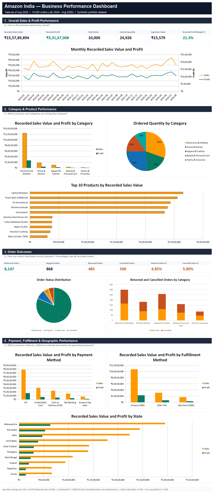

# Amazon India Business Performance Dashboard

An Excel business intelligence dashboard that analyzes 10,000 synthetic e-commerce orders (January 2024 – August 2026) across KPIs, monthly and annual trends, category and product performance, order outcomes, payment methods, fulfillment channels, and shipping states.

> **Portfolio Transparency Notice:** This project uses a **synthetic (simulated) dataset** created for portfolio demonstration of Microsoft Excel modeling, dynamic PivotTables, and business analysis. It does **not** represent Amazon's confidential internal sales records, and findings are illustrative rather than actual Amazon India financial performance.

## Dashboard Preview

## What It Answers

1. **Overall recorded performance:** Recorded sales value, recorded profit, total orders, ordered quantity, average order value (AOV), recorded profit margin, monthly trends (Jan 2024 – Aug 2026), full-year 2024 vs 2025 growth, and like-for-like Jan–Aug 2026 YoY growth.
2. **Category and product contribution:** Recorded sales value, profit, ordered quantity, order counts, and sales share by category, plus Top 10 products ranked dynamically via PivotTable.
3. **Order outcomes:** Delivered, Shipped, Returned, and Cancelled order counts and shares (denominator: all 10,000 recorded orders), combined return + cancellation rate and associated sales value, plus category-level breakdowns.
4. **Payment, fulfillment, and geographic drivers:** Recorded sales value, profit, sales share, and return/cancellation rates by payment method, fulfillment channel, and state.

**Metric definitions:**
- **Recorded Sales Value** and **Ordered Quantity** include all order statuses (Delivered, Shipped, Returned, Cancelled) and must not be interpreted as delivered revenue or delivered units.
- **Shipped** orders are still in progress and are kept separate from **Delivered** orders.
- **Returned and Cancelled associated sales value** is the gross recorded order value tied to those statuses, not confirmed financial loss.
- **Recorded Profit Margin** uses `SUM(Profit_INR) / SUM(Total_Sales_INR)` on the supplied profit column. Because all 985 Returned and Cancelled rows carry `Profit_INR = 0`, excluding those statuses mechanically raises the recorded margin from **21.29%** to **23.67%** (Delivered + Shipped; **23.59%** for Delivered only) by shrinking the denominator rather than indicating higher per-order profitability.

## Dataset & Methodology

- **Source & nature:** 10,000 synthetic order records spanning `2024-01-01` to `2026-08-30` (`Raw_Data` sheet, Excel Table `RawData`).
- **Columns (14):** `Order_ID`, `Order_Date`, `Order_Month` (calculated column `=TEXT([@[Order_Date]],"yyyy-mm")`), `Category`, `Product`, `Quantity`, `Unit_Price_INR`, `Discount_Pct`, `Total_Sales_INR`, `Profit_INR`, `Payment_Method`, `Fulfillment`, `Order_Status`, and `Ship_State`.
- **Synthetic pricing & margin assumptions (important limitations):**
  - Within each category, all five products share an identical uniform unit-price band (e.g., all `Electronics & Mobiles` items—including `Laptop Backpack`, `Power Bank 20000mAh`, and `5G Smartphone`—span ₹800–₹34,993 with medians around ₹17,300–₹18,100). Consequently, `Laptop Backpack` ranks #1 in recorded sales (₹2.65 Cr) ahead of `5G Smartphone` (₹2.43 Cr) due to simulated pricing and order volume, not real-world retail pricing.
  - Across all five categories, per-order profit margins on Delivered and Shipped orders follow the same uniform 12.0%–35.0% range (mean 23.3%–23.7%). Product rankings and category profitability should therefore be interpreted as illustrative demonstrations of analytical methodology.
- **Data cleaning & validation:** Detailed validation checks (missing values, duplicates, date conversion, discount bounds, and label consistency) are documented in [Data_Cleaning_Process.md](./Data_Cleaning_Process.md).

## What the Data Shows (Illustrative Findings)

Every metric below is formula-driven and directly traceable to the workbook's summary sheets:

- **Recorded sales, profit, and margins (`Dashboard`, `Order_Status`):** Recorded sales value is **₹15.58 crore** (₹15,57,89,894) and recorded profit is **₹3.32 crore** (₹3,31,67,008), giving an overall recorded profit margin of **21.29%**. Excluding Returned and Cancelled orders (Delivered + Shipped, 9,015 orders, ₹14.01 crore sales), recorded margin is **23.67%** (**23.59%** on the 8,147 Delivered-only orders).
- **Annual & like-for-like growth (`Annual_Analysis`):**
  - **Full-year 2024 vs 2025:** Recorded sales increased from **₹5.70 crore** (3,705 orders; AOV ₹15,388) to **₹5.74 crore** (3,744 orders; AOV ₹15,338)—a **+0.73%** increase driven by **+1.05%** order-volume growth partially offset by a **−0.32%** AOV change.
  - **Like-for-like partial year (Jan–Aug):** Because 2026 covers only January–August, it is excluded from full-year comparisons and evaluated against equivalent Jan–Aug periods. Jan–Aug 2026 recorded sales (**₹4.14 crore**, 2,551 orders) grew **+7.52% YoY** vs Jan–Aug 2025 (**₹3.85 crore**, 2,482 orders), with orders up **+2.78%** and profit up **+9.61%**.
- **Category concentration (`Category_Analysis`, `Annual_Analysis`):** `Electronics & Mobiles` contributes **79.32%** of recorded sales (₹12.36 crore) from **30.45%** of orders (3,045 orders)—a pattern that holds consistently across 2024, 2025, and Jan–Aug 2026.
- **Returned and cancelled orders (`Order_Status`, `Category_Returns_Cancellations`):** Out of 10,000 orders, **485** are Returned (**4.85%**) and **500** are Cancelled (**5.00%**), a combined rate of **9.85%** carrying **₹1.56 crore** (₹1,56,48,743; 10.04% of recorded sales) in associated sales value. Across categories, the combined rate ranges from **8.81%** (`Pantry & Groceries`) to **10.61%** (`Beauty & Personal Care`).
- **Fulfillment performance (`Fulfillment_Analysis`):** `Amazon (FBA)` accounts for **69.02%** of recorded sales (7,054 orders) with a **9.31%** combined R+C rate (**4.76%** returned, **4.55%** cancelled), compared with `Seller Flex` (**20.03%** sales; **11.24%** R+C: **4.93%** returned, **6.31%** cancelled) and `Merchant (FBM)` (**10.95%** sales; **10.92%** R+C: **5.31%** returned, **5.61%** cancelled).
- **Payment methods (`Payment_Analysis`):** `UPI` accounts for **50.40%** of recorded sales (4,972 orders; **9.88%** R+C: 4.87% returned, 5.01% cancelled), followed by `Credit/Debit Card` (**19.94%** sales; **11.04%** R+C), `Cash on Delivery (COD)` (**14.83%** sales; **9.05%** R+C), `Net Banking` (**9.90%** sales; **9.47%** R+C), and `Amazon Pay Later` (**4.93%** sales; **7.63%** R+C).
- **Geography (`State_Analysis`):** `Maharashtra` (18.97%), `Karnataka` (15.67%), and `Delhi` (14.35%) together contribute **49.00%** of recorded sales (₹7.63 crore across 4,799 orders).

## Recommendations (Illustrative Business Actions)

1. **Manage category concentration risk:** Because `Electronics & Mobiles` drives 79.32% of recorded sales, evaluate growth pilots in `Home & Kitchen` (11.54%) and `Apparel & Fashion` (6.31%) using delivered-order value, order counts, and realized margins before scaling.
2. **Track return and cancellation reasons separately:** Capture granular reason codes (delivery delay, damaged item, buyer remorse) for Returned vs Cancelled orders. Prioritize `Electronics & Mobiles` first because its high AOV concentrates the largest associated sales value, even though its combined R+C rate (9.85%) matches the portfolio average.
3. **Validate segment gaps as hypotheses, not causes:** Observed R+C rate differences—such as `Seller Flex` (11.24%) vs `Amazon (FBA)` (9.31%) or `Credit/Debit Card` (11.04%) vs `Amazon Pay Later` (7.63%)—should be tested for statistical significance and controlled for category mix, order value, and time period before operational changes.
4. **Monitor growth drivers consistently:** While full-year 2024→2025 growth was flat (+0.73%: +1.05% volume, −0.32% AOV), like-for-like Jan–Aug 2026 grew +7.52% YoY. Continue tracking volume, AOV, and category mix on matched calendar windows rather than comparing partial years to full years.

## How It's Built

The `Raw_Data` sheet stores all 10,000 orders in an Excel Table named `RawData` (`A1:N10001`). Every KPI, summary table, and chart references structured table columns (`RawData[...]`) so new rows added to the table flow into calculations automatically.

| Sheet | Purpose |
|---|---|
| `Dashboard` | Executive dashboard: 12 KPI cards, 9 charts across 4 business sections, dynamic header & footnote |
| `Raw_Data` | 10,000 source records in Excel Table `RawData` + calculated `Order_Month` column |
| `Monthly_KPIs` | 32-month time series (`2024-01` to `2026-08`) of Sales, Profit, Orders, Units, AOV, Margin |
| `Annual_Analysis` | Full-year 2024/2025 growth decomposition, like-for-like Jan–Aug YoY, and YoY category shares |
| `Category_Analysis` | Category Sales, Profit, Ordered Quantity, Sales Share %, Orders, and Profit Margin % |
| `Product_Summary` | PivotTable (`PivotTable1`) dynamically ranking Top 10 products by Recorded Sales Value |
| `Top_Products` | Links ranked Top 10 products from `Product_Summary` to Dashboard Chart 4 + `INDEX/MATCH` category |
| `Order_Status` | Status counts, shares, sales, profit, margins, combined R+C, Excl. R/C, and Delivered-only audits |
| `Category_Returns_Cancellations` | Category Returned & Cancelled counts, total orders, and combined R+C % |
| `Payment_Analysis` | Payment Sales, Profit, Sales Share %, Orders, and Returned / Cancelled / Combined R+C % |
| `Fulfillment_Analysis` | Fulfillment Sales, Profit, Sales Share %, Orders, and Returned / Cancelled / Combined R+C % |
| `State_Analysis` | State Sales, Profit, Orders, Sales Share %, R+C rates, and Top-3 states rollup |

### Updating the Dashboard

- Keep Excel calculation set to **Formulas → Calculation Options → Automatic** so all formula-based summaries and the dynamic Dashboard subtitle/footnote recalculate automatically when `RawData` changes.
- Select **Data → Refresh All** to update `PivotTable1` (`Product_Summary`) and the Top 10 ranking (`Top_Products`). The PivotTable is also configured to refresh on open.
- **Current limitations:** Grouping label lists (months, categories, payment methods, fulfillment methods, states, order statuses) are maintained manually on the summary sheets; introducing a brand-new month or label requires adding a corresponding row and extending chart ranges.

## Tools

**Microsoft Excel:** Excel Tables (`RawData`), structured references, `SUMIFS`, `COUNTIFS`, `IFERROR`, `TEXT`, `UNICHAR`, `INDEX/MATCH`, PivotTables, and native charts.

## Using It

1. Download [the Excel workbook](https://raw.githubusercontent.com/PoojaS-1616/data-analysis/main/amazon-indian-business-dashboard-main/Amazon_India_Business_Performance_Dashboard.xlsx) and open it in Microsoft Excel (the workbook opens directly on the **Dashboard** tab).
2. Ensure **Formulas → Calculation Options → Automatic** is enabled.
3. To append new records, add rows directly inside the `RawData` table on `Raw_Data` using true Excel dates in `Order_Date`; `Order_Month` (`=TEXT([@[Order_Date]],"yyyy-mm")`) fills automatically.
4. Select **Data → Refresh All** to refresh the Top 10 product PivotTable (press **Ctrl + Alt + F9** if a full recalculation is needed).
5. Review [Data_Cleaning_Process.md](./Data_Cleaning_Process.md) for the complete validation and preparation notes.

## What I Learned

Designing for executive and non-technical readers requires as much discipline in **metric definitions and transparency** as in Excel modeling: clearly separating recorded sales from delivered revenue, disclosing synthetic data constraints upfront, and ensuring every headline number in prose is backed by a traceable, refreshable formula in the workbook.
